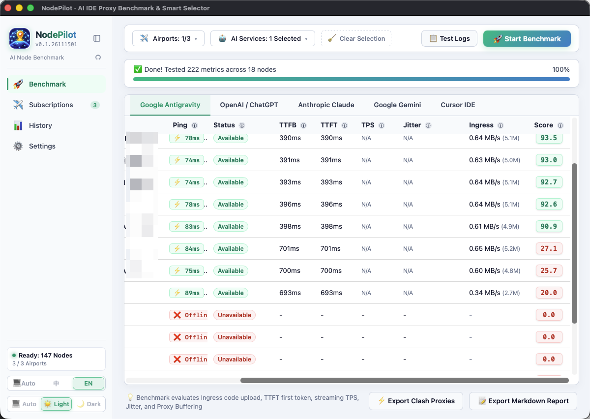

# NodePilot


[简体中文](README.md) | [English](README_en.md)

> 专门针对 AI IDE（Antigravity、Cursor、Windsurf、GitHub Copilot、Claude Code 等）的大模型网络通信基准测试与分服务智能优选工具。

传统代理测速工具（Ping、TCP 握手、Speedtest 下行测速）无法真实反映 AI 辅助编程的实际体验。NodePilot 摒弃单一延迟指标，针对大模型大上下文代码上传（Ingress Payload）、长连接流式响应（SSE / Chunked）以及中转代理的聚合缓冲（Proxy Buffering）等痛点，提供全维度的量化评测模型与各服务专属的优选策略组导出。

---

## 🖥 界面预览



---

## ✨ 核心特性

- **LLM 全链路性能度量**：
  - **网络建连层**：DNS 解析、TCP 握手、TLS 协商耗时；
  - **首字与吞吐层**：首字节时延（TTFB）、首 Token 时延（TTFT）、每秒 Token 输出速率（TPS）；
  - **流式平滑度与抖动**：统计 Chunk 到达时间间隔方差（Jitter Variance）与最大停顿（Max Gap）；
  - **大上下文上传带宽 (Ingress)**：模拟上传 128KB~512KB 代码上下文 Payload，测量真实推流速率；
  - **代理聚合缓冲检测 (Proxy Buffering Detection)**：自动识别机场节点是否存在对流式 Chunk 积攒数秒后暴吐的劫持行为并施加降级惩罚。
- **解耦的多态可用性状态机**：
  - 彻底区分网络通路与鉴权状态，杜绝将 HTTP 401/403 盲目判定为网络故障；
  - 精确标记 `Available`、`Authentication Required`、`Restricted`（地域/Cloudflare 阻断）、`Timeout`、`Unavailable`。
- **AI 服务感知与独立排行榜**：
  - 为不同 AI 平台（Google Antigravity、Google Gemini、OpenAI、Anthropic Claude、Cursor）分别打分与排序；
  - 彻底解决“节点 A 跑 Gemini 飞快但在 Antigravity 上完全连不上”的木桶短板。
- **服务级最优策略组一键导出**：
  - 自动生成各服务专属的最优策略组配置（如 `🤖 Antigravity-Best`、`🧠 OpenAI-Best`）；
  - 输出标准 Clash / Mihomo YAML 规则组，实现不同 AI 流量自动走向各自的最优节点。
- **声明式探针扩展体系**：
  - 支持通过声明式 YAML 配置文件增加新兴 AI IDE 或私有反代端点探针，无需改动核心代码。

---

## 📂 项目结构

```text
.
├── app/                 # Wails v2 桌面客户端 (Go + 原生前端)
│   ├── frontend/        # 前端资源 (原生 JS/CSS/HTML，无重型框架依赖)
│   ├── main.go          # 桌面应用入口
│   └── wails.json       # Wails 桌面端配置
├── engine/              # 核心测速与分析引擎 (Go)
│   ├── cmd/             # Cobra CLI 命令行入口与参数调度
│   ├── pkg/
│   │   ├── model/       # 核心实体、状态机与指标模型定义
│   │   ├── parser/      # Clash / Mihomo 配置文件与订阅解析器
│   │   ├── probe/       # 内置 AI 探针与自定义 YAML 探针加载器
│   │   ├── runner/      # httptrace 追踪、SSE 流式分析、Ingress 测速与并发引擎
│   │   ├── scorer/      # 归一化综合评分与各服务独立排名算法
│   │   └── exporter/    # Clash 策略组生成与 Markdown/终端看板导出
│   ├── go.mod
│   └── main.go          # 引擎入口
├── docs/                # 文档与设计资产
├── logs/                # 开发演化思考日志
├── changes/             # 版本发布变更记录
└── README.md
```

---

## 🚀 快速上手

### 1. 环境准备
- [Go](https://go.dev/) 1.22+
- [Wails CLI v2](https://wails.io/)（桌面 GUI 开发与热重载必需）：
  ```bash
  go install github.com/wailsapp/wails/v2/cmd/wails@latest
  ```

### 2. 本地开发与实时热重载 (边开发边查看 UI 与功能)

#### 桌面 GUI 实时开发：
进入 `app/` 目录运行：
```bash
cd app && wails dev
```
运行后将开启完整的实时热重载与调试环境：
- **前端实时热更新 (HMR)**：修改 `app/frontend/src/` 中的 HTML / CSS / JS，保存后桌面窗口与视图自动实时刷新，无需手动刷新或重新编译；
- **后端 Go 代码自动热重编**：修改 `app/` 或底层 `engine/` 的 Go 逻辑代码，Wails 会自动捕获变更、增量重新编译并重启原生进程；
- **原生 DevTools 审查**：在桌面应用窗口中右键点击选择 **检查 (Inspect Element)**（或按 `F12` / `⌥ + ⌘ + I`），呼出原生 WebKit/WebView2 开发者控制台，实时查看 Console 输出、网络请求与 DOM；
- **浏览器独立调试**：可在 Chrome / Safari 中直接访问 `http://localhost:34115`，利用标准浏览器开发工具调试样式与交互，此时 `window.go` 后端 API 依然无缝连通。

#### CLI 核心引擎快速验证：
若仅针对 `engine/` 核心测速算法与探针进行开发，可在根目录下直接编译执行本地对照测试：
```bash
cd engine && go build -o ../bin/engine main.go && cd ..
./bin/engine --direct
```

### 3. 生产编译与跨平台打包 (Build Commands)

NodePilot 提供根目录**一键跨平台自动化构建脚本** `./build.sh`，支持交互式选择与命令行传参，产物统一自动归档至专门的 `release/` 平台子目录。

#### 统一产物目录结构 (`release/`)
```text
release/
├── macos/     # macOS 桌面端 (NodePilot-macOS-Universal.dmg 拖拽安装镜像 & NodePilot.app)
├── windows/   # Windows 独立运行程序 (NodePilot.exe，单文件免安装即开即用)
├── linux/     # Linux 原生桌面端 (NodePilot)
└── cli/       # (开发者选配) 三大平台无依赖静态交叉编译 CLI 核心引擎
```

---

#### 🌟 推荐：一键统一构建脚本 (`./build.sh`)

赋予执行权限后直接在项目根目录下运行：

```bash
chmod +x ./build.sh
./build.sh
```

运行后将展示交互式平台选择菜单，**输入 `0` 即可一键生成全套桌面端安装包**：
```text
==================================================================
                 NodePilot 跨平台统一构建打包工具                 
==================================================================
 [0] 全部桌面端生成 (macOS DMG/App + Windows EXE + Linux 桌面端)
 [1] 生成 macOS 桌面端 (NodePilot.app 与 DMG 拖拽安装镜像)
 [2] 生成 Windows 桌面端 (release/windows/NodePilot.exe)
 [3] 生成 Linux 平台产物 (release/linux/)
 [4] (开发者选配) 仅生成底层 CLI 核心引擎 (release/cli/)
 [q] 退出
==================================================================
请输入目标编号 [0-4 / q] (默认 0): 
```

脚本亦支持**命令行无交互直接调用**（适合 CI/CD 自动化流水线）：
```bash
./build.sh 0       # 全部桌面端生成 (macOS DMG + Windows EXE + Linux)
./build.sh mac     # 仅构建 macOS 桌面端及 DMG 镜像至 release/macos/
./build.sh win     # 仅构建 Windows 桌面端至 release/windows/
./build.sh linux   # 仅构建 Linux 桌面端至 release/linux/
./build.sh cli     # (开发者选配) 交叉编译三大平台 CLI 引擎至 release/cli/
```

---

#### 附：各平台底层原生构建命令参考

##### 🍎 macOS (Apple Silicon & Intel)
```bash
cd app

# 针对当前本机架构直接构建
wails build

# 生成支持 Intel + Apple Silicon 的通用双架构安装包 (Universal Binary)
wails build -platform darwin/universal
```
> **产物路径**：`release/macos/NodePilot-macOS-Universal.dmg`（内置 Applications 快捷替身，支持双击一键拖拽安装）。

##### 🪟 Windows (Windows 10 / 11)
```bash
cd app

# 构建 Windows 64位独立可执行程序 (.exe)
wails build -platform windows/amd64

# 生成带有标准安装引导程序的安装包 (需系统安装 NSIS)
wails build -platform windows/amd64 -nsis
```
> **产物路径**：`release/windows/NodePilot.exe`（单文件免安装即开即用，底层使用原生 WebView2 运行时）。

##### 🐧 Linux (Ubuntu / Debian / Fedora / Arch)
```bash
cd app

# 构建 Linux 64位 x86_64 可执行程序 (Ubuntu 24.04+ 支持 WebKit2GTK 4.1)
wails build -platform linux/amd64 -tags webkit2_41

# 构建 Linux ARM64 可执行程序
wails build -platform linux/arm64 -tags webkit2_41
```
> **产物路径**：`release/linux/NodePilot`（赋予执行权限 `chmod +x ./NodePilot && ./NodePilot` 即可运行）。  
> *注：Linux 平台构建或运行需宿主系统安装 GTK3 与 WebKitGTK 库（如 Ubuntu/Debian: `sudo apt install libgtk-3-dev libwebkit2gtk-4.1-dev`）。*

---

## 💡 桌面端快速上手

1. **导入订阅与节点**：在左侧「订阅管理」中粘贴你的 Clash / 原生 URI 订阅链接，或通过剪贴板快速解析导入；
2. **多维筛选与检索**：支持按地区名称、传输协议或可用性评级毫秒级过滤节点；
3. **批量基准测试**：在「基准测试」界面点击「开始测速」，系统将通过高并发协程池快速测量时延、丢包率与首包时间 (TTFB)；
4. **可视化分析与优选**：通过双 Y 轴历史走势图评估节点稳定性，一键将优选节点导出为 Clash 或 Sing-box 配置。

---

## 📖 相关文档

- 核心功能特性蓝图：[FEATURES.md](FEATURES.md)
- 面向终端用户的最新发版说明：[RELEASE_NOTES.md](RELEASE_NOTES.md)
- 版本变更历史索引：[CHANGELOG.md](CHANGELOG.md)
- 详细架构与功能规约：[docs/features/](docs/features/)
