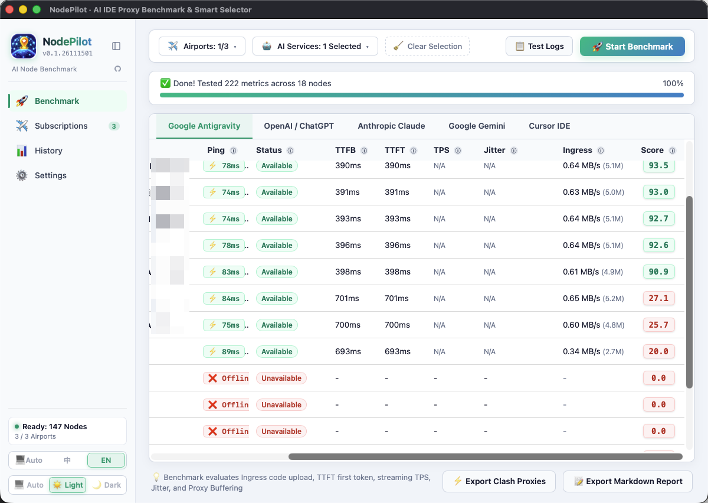

# NodePilot


[简体中文](README.md) | [English](README_en.md)

> Dedicated network benchmarking and intelligent service-specific proxy routing optimizer for AI IDEs (Google Antigravity, Cursor, Windsurf, GitHub Copilot, Claude Code, etc.).

Traditional proxy benchmarking tools (ICMP Ping, TCP handshakes, Speedtest downloads) fail to capture the actual user experience in AI-assisted programming. NodePilot moves beyond simple latency metrics. Designed specifically for large-context code uploads (Ingress Payload), persistent streaming responses (SSE / Chunked), and intermediate proxy buffering hijacking, NodePilot provides an end-to-end quantitative evaluation model and one-click export of dedicated proxy rule groups for each AI provider.

---

## 🖥 UI Showcase



---

## ✨ Key Features

- **Full-Link LLM Performance Metrics**:
  - **Connection Layer**: High-precision DNS resolution, TCP handshake, and TLS negotiation latency;
  - **First Token & Throughput**: Time-to-First-Byte (TTFB), Time-to-First-Token (TTFT), and Tokens Per Second (TPS);
  - **Streaming Smoothness & Jitter**: Statistical analysis of chunk arrival intervals (Jitter Variance) and maximum stall intervals (Max Gap);
  - **Large-Context Ingress Bandwidth**: Simulates uploading 128 KB–512 KB code payloads to measure real outbound throughput;
  - **Proxy Buffering Detection**: Automatically identifies proxies that buffer and burst streaming chunks, applying score penalties.
- **Decoupled Polymorphic Availability State Machine**:
  - Distinguishes network transport connectivity from API authorization status (HTTP 401/403 are accurately classified rather than treated as network failures);
  - Explicit states: `Available`, `Authentication Required`, `Restricted` (Geo / WAF / Cloudflare blocks), `Timeout`, and `Unavailable`.
- **Service-Aware Independent Leaderboards**:
  - Separate scoring and ranking for Google Antigravity, Google Gemini, OpenAI, Anthropic Claude, and Cursor;
  - Solves the common bottleneck where a node is extremely fast for Gemini but completely blocked for Antigravity.
- **One-Click Service-Specific Strategy Group Export**:
  - Automatically generates optimized proxy groups per service (e.g., `🤖 Antigravity-Best`, `🧠 OpenAI-Best`);
  - Exports standard Clash / Mihomo YAML configuration snippets to route distinct AI traffic to optimal nodes.
- **Declarative Probe Extension System**:
  - Add new AI IDEs or custom reverse-proxy endpoints via declarative YAML configuration files without touching core code.

---

## 📂 Project Architecture

```text
.
├── app/                 # Wails v2 desktop application (Go + native frontend)
│   ├── frontend/        # Frontend assets (Vanilla JS/CSS/HTML, zero heavy framework overhead)
│   ├── main.go          # Desktop application entry point
│   └── wails.json       # Wails desktop configuration
├── engine/              # Core speedtest & analysis engine (Go)
│   ├── cmd/             # Cobra CLI entry point & argument parsing
│   ├── pkg/
│   │   ├── model/       # Core domain entities, state machine & metric models
│   │   ├── parser/      # Clash / Mihomo configuration & subscription parser
│   │   ├── probe/       # Built-in AI probes & custom YAML loader
│   │   ├── runner/      # httptrace, SSE streaming analyzer, Ingress benchmark & concurrency pool
│   │   ├── scorer/      # Normalized scoring & per-service ranking algorithms
│   │   └── exporter/    # Clash proxy-group generator & Markdown/terminal exporter
│   ├── go.mod
│   └── main.go          # Headless engine entry point
├── docs/                # Documentation & design assets
├── logs/                # Engineering evolutionary thinking logs
├── changes/             # Version release changelogs
└── README.md
```

---

## 🚀 Quick Start

### 1. Prerequisites
- [Go](https://go.dev/) 1.22+
- [Wails CLI v2](https://wails.io/) (Required for desktop GUI development & builds):
  ```bash
  go install github.com/wailsapp/wails/v2/cmd/wails@latest
  ```

### 2. Local Development & Live Reload

#### Desktop GUI Live Development:
Navigate to the `app/` directory and run:
```bash
cd app && wails dev
```
This launches a complete hot-reloading development environment:
- **Frontend Hot Module Replacement (HMR)**: Changes in `app/frontend/src/` (HTML, CSS, JS) instantly reload the view without restarting;
- **Backend Go Auto-Recompile**: Changes in `app/` or `engine/` Go code trigger an incremental recompile and process restart;
- **Native DevTools**: Right-click inside the window and select **Inspect Element** (or press `F12` / `⌥ + ⌘ + I`) to open native WebKit / WebView2 developer tools;
- **Browser Debugging**: Open `http://localhost:34115` in Chrome or Safari to inspect styles and interactions with full `window.go` IPC bindings.

#### CLI Core Engine Validation:
To test the core benchmark algorithm and probes directly in terminal:
```bash
cd engine && go build -o ../bin/engine main.go && cd ..
./bin/engine --direct
```

### 3. Production Builds & Packaging

NodePilot provides a unified root build script `./build.sh` supporting both interactive menu selection and direct command-line arguments. Artifacts are archived into the `release/` directory.

#### Unified Release Artifacts Structure (`release/`)
```text
release/
├── macos/     # macOS Desktop (NodePilot-macOS-Universal.dmg installer & NodePilot.app)
├── windows/   # Windows Portable Desktop (NodePilot.exe, standalone executable)
├── linux/     # Linux Native Desktop (NodePilot)
└── cli/       # (Optional developer tool) Cross-platform static CLI binaries
```

---

#### 🌟 Recommended: One-Click Build Script (`./build.sh`)

Grant execution permissions and run in the project root:

```bash
chmod +x ./build.sh
./build.sh
```

An interactive menu will guide your selection. **Enter `0` to build all desktop packages**:
```text
==================================================================
                 NodePilot Cross-Platform Build Tool              
==================================================================
 [0] Build All Desktop Apps (macOS DMG/App + Windows EXE + Linux)
 [1] Build macOS Desktop (NodePilot.app & Drag-and-Drop DMG)
 [2] Build Windows Desktop (release/windows/NodePilot.exe)
 [3] Build Linux Desktop (release/linux/)
 [4] (Developer Option) Build Core CLI Engine (release/cli/)
 [q] Exit
==================================================================
Please select target [0-4 / q] (default 0): 
```

You can also run it non-interactively in CI/CD pipelines:
```bash
./build.sh 0       # Build all desktop packages (macOS DMG + Windows EXE + Linux)
./build.sh mac     # Build macOS desktop App and DMG installer to release/macos/
./build.sh win     # Build Windows 64-bit EXE to release/windows/
./build.sh linux   # Build Linux desktop to release/linux/
./build.sh cli     # (Developer Option) Cross-compile CLI engines to release/cli/
```

---

#### Native Platform Build Commands Reference

##### 🍎 macOS (Apple Silicon & Intel)
```bash
cd app

# Build for current host architecture
wails build

# Build Universal Binary (Intel + Apple Silicon)
wails build -platform darwin/universal
```
> **Output**: `release/macos/NodePilot-macOS-Universal.dmg` (standard drag-and-drop installer containing `/Applications` symlink).

##### 🪟 Windows (Windows 10 / 11)
```bash
cd app

# Build Windows 64-bit standalone executable (.exe)
wails build -platform windows/amd64

# Build with NSIS installer (requires NSIS installed)
wails build -platform windows/amd64 -nsis
```
> **Output**: `release/windows/NodePilot.exe` (portable standalone binary, powered by native WebView2 runtime).

##### 🐧 Linux (Ubuntu / Debian / Fedora / Arch)
```bash
cd app

# Build Linux 64-bit x86_64 binary (Ubuntu 24.04+ with WebKit2GTK 4.1)
wails build -platform linux/amd64 -tags webkit2_41

# Build Linux ARM64 binary
wails build -platform linux/arm64 -tags webkit2_41
```
> **Output**: `release/linux/NodePilot` (`chmod +x ./NodePilot && ./NodePilot` to execute).  
> *Note: Building or running on Linux requires GTK3 and WebKitGTK (e.g., Ubuntu: `sudo apt install libgtk-3-dev libwebkit2gtk-4.1-dev`).*

---

## 💡 Desktop App Quick Start

1. **Import Subscriptions & Proxies**: Open "Subscriptions" in the sidebar, paste your Clash or standard URI subscription link, and click import;
2. **Multi-dimensional Filtering**: Filter proxies instantly by region, protocol, or availability grade;
3. **Batch Concurrent Benchmarking**: On the "Benchmark" dashboard, click "Start Benchmark" to evaluate latency, packet loss, and TTFB in real time;
4. **Visual Analytics & One-click Export**: Inspect historical stability via dual-axis charts and export optimal proxies directly as Clash or Sing-box configurations.

---

## 📖 Documentation

- Full Capabilities Blueprint: [FEATURES.md](FEATURES.md)
- Latest End-User Release Notes: [RELEASE_NOTES.md](RELEASE_NOTES.md)
- Project Release Changelog: [CHANGELOG.md](CHANGELOG.md)
- Detailed Architecture & Feature Specifications: [docs/features/](docs/features/)
