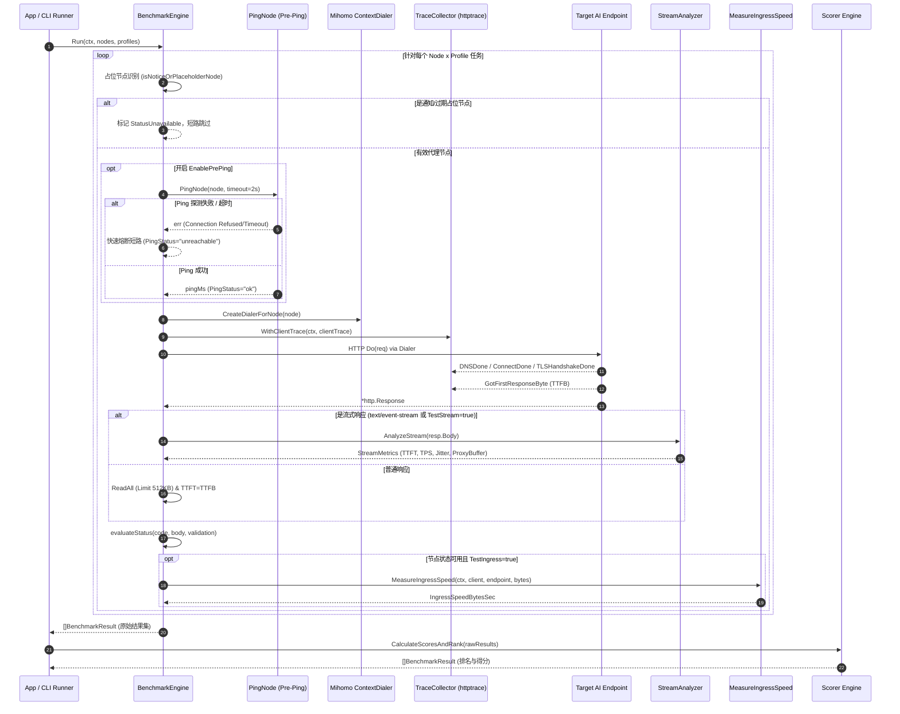
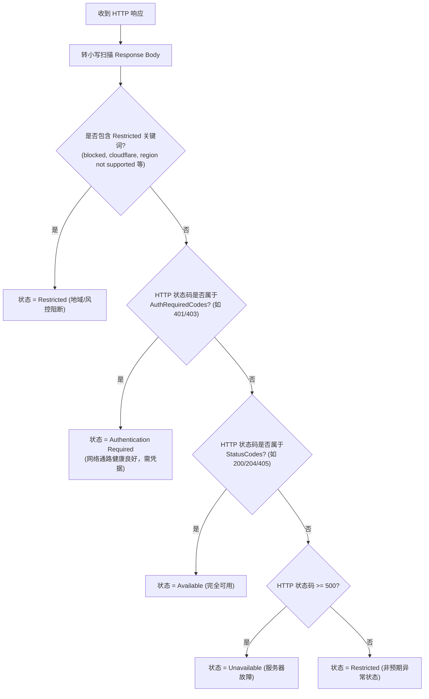

# NodePilot 评测引擎、服务探针与评分体系特性规约 (Benchmark Engine, Probes & Scorer Specification)

## 一、 功能背景与第一性原理动机 (Overview & Motivation - Why)

### 1.1 业务背景与传统痛点
在主流 AI 辅助编程与 AI IDE（如 Google Antigravity、Cursor、Windsurf、GitHub Copilot、Claude Code 等）的重度开发场景中，工程师高度依赖海外代理/VPN 节点。传统代理测速工具（如基于 ICMP Ping、简单 TCP 握手测速、普通网页测速或单纯测试单线程/多线程下载带宽）**完全无法真实反映 AI 辅助编程的实际交互体验**：

1. **服务间路由与可用性割裂**：
   - 节点 A 访问 Google Gemini 极快，但访问 Google Antigravity 核心端点直接超时；
   - 节点 B 访问 OpenAI 顺畅，但由于机房落地 IP 属于数据中心黑名单，被 Google AI 识别为风控流量直接拦截；
   - 传统工具仅以单一网站（如 Google 搜索或 Cloudflare 测速页）评判全局连通性，导致选中的“优质节点”在关键 AI IDE 中频频报错。
2. **Ping 延迟与 Token 吐出速率严重脱节**：
   - 某些节点 TCP Ping 低至 30ms，但请求 AI 服务时模型吐字断断续续，TPS（Tokens Per Second）极低；
   - 反之，某些跨大洋物理延迟 150ms 的直连线路，流式吐字速率平稳且极高。
3. **大上下文 (Ingress) 上行瓶颈成为致命卡点**：
   - 现代 AI IDE（如 Antigravity 智能体、Cursor Composer）单次请求常需打包数十个关联代码文件、AST 语法树与 Git Diff，上行 Prompt Payload 动辄达 128KB ~ 512KB 甚至更高；
   - 多数机场节点下行大带宽（用于 4K 视频），但上行带宽被 QoS 严重削减（< 100KB/s），导致 IDE 每次发起补全在客户端阶段发生严重卡顿滞后。
4. **代理聚合缓冲 (Proxy Buffering Hijacking) 破坏流式体验**：
   - 部分中转机场或廉价中继为节省 TCP 资源，对 HTTP Chunked / Server-Sent Events (SSE) 流式传输实施了缓冲合并策略，导致原本平滑逐步吐出的代码流变成“客户端卡死 3~5 秒后瞬间暴吐一整屏”，破坏了开发者即时审阅与打断补全的流式交互。
5. **混淆应用层鉴权与网络通路**：
   - 传统检测将 HTTP 401（未授权）或 403（需要特定凭证）直接判定为“节点不可用/失败”，忽视了其底层 TCP/TLS 链路和路由完全健康可达的客观事实。

### 1.2 NodePilot 第一性原理解决方案
NodePilot 将评测核心聚焦于 **“以 AI 服务为感知中心 (AI Service-Aware)、全链路度量通信生命周期、多态可用性状态解耦与动态加权评分”**：
- **微秒级全链路分解**：细分 DNS、TCP、TLS、TTFB、TTFT、TPS、Jitter、Ingress 八维指标；
- **智能短路熔断 (Fail-Fast)**：前置 Ping 探测与占位节点智能识别，过滤无效开销；
- **真实出站隧道**：内嵌 Mihomo 原生内核，保障 Shadowsocks, VMess, VLESS, Trojan, Hysteria2, TUIC 等协议高保真穿透；
- **抗漂移评分引擎**：Min-Max 动态归一化与动态激活权重，严禁无数据产生虚假高分，对聚合缓冲实施刚性降权。

---

## 二、 核心数据模型与抽象定义 (Data Models - What)

源码定义位置：[types.go](../../engine/pkg/model/types.go)

### 2.1 多态可用性状态枚举 (`AvailabilityStatus`)
解耦网络层畅通与应用层业务响应，定义五态状态机：

```go
type AvailabilityStatus string

const (
    StatusAvailable              AvailabilityStatus = "Available"               // 节点连通且业务返回预期状态码 (200/204 等)
    StatusAuthenticationRequired AvailabilityStatus = "Authentication Required" // 网络通路健康，端点需要鉴权 (401/403)
    StatusRestricted             AvailabilityStatus = "Restricted"              // 遭遇地域/策略封锁 (WAF/Cloudflare/Region Not Supported)
    StatusTimeout                AvailabilityStatus = "Timeout"                 // TCP 连接超时、TLS 握手超时或首字节响应超时
    StatusUnavailable            AvailabilityStatus = "Unavailable"            // 连接被拒绝、DNS 解析失败、TCP 重置 (RST) 等底层不可达
)
```

### 2.2 节点统一模型 (`Node`)
```go
type Node struct {
    AirportName string                 `json:"airport_name,omitempty" yaml:"airport_name,omitempty"`
    Name        string                 `json:"name" yaml:"name"`
    Type        string                 `json:"type" yaml:"type"`
    Server      string                 `json:"server" yaml:"server"`
    Port        int                    `json:"port" yaml:"port"`
    Password    string                 `json:"password,omitempty" yaml:"password,omitempty"`
    Raw         map[string]interface{} `json:"raw,omitempty" yaml:"raw,omitempty"`
}
```

### 2.3 网络阶段度量指标 (`NetworkMetrics`)
```go
type NetworkMetrics struct {
    DNSLookup    time.Duration `json:"dns_lookup"`    // 域名解析耗时
    TCPConnect   time.Duration `json:"tcp_connect"`   // 底层 TCP 握手耗时
    TLSHandshake time.Duration `json:"tls_handshake"` // TLS 协商耗时
    TTFB         time.Duration `json:"ttfb"`          // Time to First Byte (首字节到达耗时)
    TotalTime    time.Duration `json:"total_time"`    // 全流程耗时
}
```

### 2.4 LLM 流式输出专属度量指标 (`StreamMetrics`)
```go
type StreamMetrics struct {
    TTFT                 time.Duration `json:"ttft"`                   // Time-to-First-Token (首个有效 Token/Chunk 到达时延)
    TPS                  float64       `json:"tps"`                    // 每秒输出 Token/Chunk 速率 (Tokens Per Second)
    TotalTokens          int           `json:"total_tokens"`           // 收到的 Token/Chunk 总数
    JitterVarianceMs     float64       `json:"jitter_variance_ms"`     // Chunk 到达间隔的方差 (ms^2)
    MaxChunkGap          time.Duration `json:"max_chunk_gap"`          // 两次 Chunk 间的最大卡顿时长
    ProxyBufferDetected  bool          `json:"proxy_buffer_detected"`  // 是否触发代理聚合缓冲劫持判定
    IngressSpeedBytesSec float64       `json:"ingress_speed_byte_sec"` // 上行代码大上下文速率 (Bytes/s)
}
```

### 2.5 单次评测结果对象 (`BenchmarkResult`)
```go
type BenchmarkResult struct {
    AirportName string             `json:"airport_name,omitempty"`
    NodeName    string             `json:"node_name"`
    ServiceName string             `json:"service_name"`
    AIOffer     string             `json:"ai_offer,omitempty"`
    Status      AvailabilityStatus `json:"status"`
    StatusCode  int                `json:"status_code"`
    PingMs      int64              `json:"ping_ms"`            // 节点连通往返时延 (RTT，毫秒)
    PingStatus  string             `json:"ping_status"`        // "ok" | "unreachable" | "timeout" | "skipped"
    Network     NetworkMetrics     `json:"network"`
    Stream      StreamMetrics      `json:"stream"`
    Score       float64            `json:"score"`              // 0 ~ 100 分制加权得分
    Rank        int                `json:"rank,omitempty"`     // 分服务独立排名 (-1 代表不可用)
    ErrorMsg    string             `json:"error_msg,omitempty"`
    TestedAt    time.Time          `json:"tested_at"`
}
```

### 2.6 探针定义与验证规则模型 (`ProbeProfile` & `ValidationRule`)
```go
type ProbeProfile struct {
    ID                  string            `json:"id" yaml:"id"`
    Name                string            `json:"name" yaml:"name"`
    Category            string            `json:"category" yaml:"category"`
    Method              string            `json:"method" yaml:"method"`
    Endpoint            string            `json:"endpoint" yaml:"endpoint"`
    Headers             map[string]string `json:"headers,omitempty" yaml:"headers,omitempty"`
    BodyPayload         string            `json:"body_payload,omitempty" yaml:"body_payload,omitempty"`
    Validation          ValidationRule    `json:"validation" yaml:"validation"`
    TestIngress         bool              `json:"test_ingress" yaml:"test_ingress"`
    IngressPayloadBytes int               `json:"ingress_payload_bytes" yaml:"ingress_payload_bytes"`
    TestStream          bool              `json:"test_stream" yaml:"test_stream"`
    APIKey              string            `json:"api_key,omitempty" yaml:"api_key,omitempty"`
    CustomModel         string            `json:"custom_model,omitempty" yaml:"custom_model,omitempty"`
}

type ValidationRule struct {
    StatusCodes        []int    `json:"status_codes" yaml:"status_codes"`
    AuthRequiredCodes  []int    `json:"auth_required_codes" yaml:"auth_required_codes"`
    RestrictedKeywords []string `json:"restricted_keywords" yaml:"restricted_keywords"`
    ExpectedContent    string   `json:"expected_content" yaml:"expected_content"`
}
```

---

## 三、 评测执行管道与网络拨号架构 (Runner & Dialer Pipeline - How)

源码对应位置：
- 评测引擎调度：[engine.go](../../engine/pkg/runner/engine.go)
- 网络拨号适配：[dialer.go](../../engine/pkg/runner/dialer.go)
- 网络阶段追踪：[tracer.go](../../engine/pkg/runner/tracer.go)

### 3.1 评测执行全链路时序图



### 3.2 占位与通知节点智能识别过滤
机场订阅中普遍混入诸如“剩余流量：100G”、“到期时间：2026-12-31”、“官网：xxx”、“通知频道”等虚假占位节点，如果对每个节点发起深度 AI 测速，将导致整个测试耗时膨胀数倍甚至引发超时。

`isNoticeOrPlaceholderNode` 过滤逻辑：
- 节点名称关键词不区分大小写匹配：`失效`、`重新复制`、`重新导入`、`到期`、`剩余流量`、`更新订阅`、`官网`、`购买`、`公告`、`通知`、`群组`、`频道`、`notice`、`expire`、`traffic`、`update`、`website`；
- 地址异常判定：`Server == ""` 或指向回环地址 `127.0.0.1`、`0.0.0.0`、`localhost`，或 `Port <= 0`。
- 命中时直接短路返回 `StatusUnavailable`，`PingStatus = "unreachable"`，耗时 0ms。

### 3.3 前置 Ping 探测与快速短路熔断 (Fail-Fast)
在 `EngineOptions.EnablePrePing = true` 时，引擎执行深度测试前先对底层节点发起轻量探测，默认超时为 2 秒：
- **TCP 协议族（Trojan, SS, VMess, VLESS 等）**：直接向 `node.Server:node.Port` 发起轻量 TCP 握手，测量底层网络往返 RTT；
- **UDP/QUIC 协议族（Hysteria2, TUIC, WireGuard 等）**：由于 UDP 端口无法直接发起 TCP 握手，引擎调用出站代理隧道，向极轻量级公共可达端点（`cp.cloudflare.com:80`）发起握手探测，验证底层 QUIC 连接与加密凭据；
- **熔断机制**：若轻量探测超时或端口被重置（RST），立即将该节点标记为不可用，跳过后续耗时漫长的 AI 握手、流式分析与 Ingress 测速。

### 3.4 Mihomo 原生 Outbound 代理隧道集成与回退体系
NodePilot 不依赖外部常驻进程或本地临时开启的端口转发，而是内嵌集成 Mihomo (Clash.Meta) 原生内核适配层：
1. **优先实例化原生 Proxy 适配器**：
   - 将 `Node` 的字段与 `Node.Raw` 注入 `adapter.ParseProxy(mapping)`；
   - 原生支持：`ss`、`ssr`、`vmess`、`vless`、`trojan`、`hysteria`、`hysteria2`、`tuic`、`wireguard`、`snell`、`socks5`、`http` 全量协议栈；
   - 由 `mihomoProxyDialer` 直接接管 `net.Conn` 的建立，具备完整的 TLS 混淆、XTLS、Vision、Reality、Shadow-TLS 与 gRPC 传输承载能力。
2. **安全回退机制**：
   - 若解析失败，针对标准 `socks5` 协议回退到标准库 `golang.org/x/net/proxy`；
   - 针对 `http` 代理回退到标准 HTTP CONNECT；
   - 兜底为 `directDialer`，确保引擎具备自愈性且不会崩溃。

### 3.5 全链路微秒级网络时延追踪 (`TraceCollector`)
基于 Go 标准库 `net/http/httptrace` 构建微秒级时钟钩子：
- `DNSStart` / `DNSDone`：精确记录从发起域名查询到获取 IP 耗时；
- `ConnectStart` / `ConnectDone`：记录底层 TCP 握手耗时；
- `TLSHandshakeStart` / `TLSHandshakeDone`：记录 TLS 密钥协商与证书校验耗时；
- `GotFirstResponseByte`：记录首字节返回时刻，计算微秒级 TTFB；
- **保底防御机制**：通过部分特殊代理中继时，底层连接可能由代理内部池化，导致 httptrace 的 Connect 钩子未被触发。引擎在 `client.Do` 返回时对比 `requestDuration`，若 `TTFB <= 0` 则以实际往返耗时作为兜底，防止出现“0ms 幽灵数据”。

---

## 四、 LLM 专属评测指标实现机制 (LLM Performance Metrics - How)

源码对应位置：
- 流式分析器：[stream.go](../../engine/pkg/runner/stream.go)
- 上行带宽评测：[ingress.go](../../engine/pkg/runner/ingress.go)

### 4.1 TTFB 与 TTFT 测量
- **TTFB (Time-to-First-Byte)**：从发起 HTTP 请求（含 Header 发送）到从 TCP 缓冲区读到响应报文第一字节的耗时。反映网络链路与服务端 Web 容器的就绪时延；
- **TTFT (Time-to-First-Token)**：从发起请求到收到服务端推送的首个有效 SSE Token/Chunk 数据包的时间戳。
  - 对于流式探针，`TTFT = FirstChunkTime - RequestStartTime`；
  - 对于非流式探针或普通 API，TTFT 自动保底对齐 `Network.TTFB`。

### 4.2 TPS (Tokens Per Second) 动态计算模型
在流式读取过程中，`StreamAnalyzer` 过滤掉心跳空行和 `:` 开头的注释行，记录所有有效 Chunk 的到达时间序列 $[t_0, t_1, t_2, \dots, t_{n-1}]$：
- 若总有效 chunk 数 $n \le 1$：
  - $n = 1$ 时标记 $TPS = 1.0$；
  - $n = 0$ 时标记 $TPS = 0.0$；
- 若 $n > 1$：
  $$\Delta t_{\text{stream}} = t_{n-1} - t_0$$
  $$\text{TPS} = \frac{n}{\Delta t_{\text{stream}} (\text{单位：秒})}$$
  若整段流在极短时间（$\Delta t_{\text{stream}} \to 0$）内爆发吐出，则保护性设为 $n \times 100.0$。

### 4.3 流式平滑度与抖动分析 (Jitter Variance & Max Stall Gap)
为了度量代码流式吐出的连贯度，系统收集相邻 chunk 的间隔时间（单位：毫秒）：
$$\Delta g_i = (t_i - t_{i-1}) \times 1000 \quad (i = 1, 2, \dots, n-1)$$
- **最大停顿间隙 (MaxChunkGap)**：
  $$\text{MaxChunkGap} = \max_{1 \le i < n} (t_i - t_{i-1})$$
  用于检测流式输出中途是否存在长达数秒的“假死”断流。
- **抖动方差 (Jitter Variance)**：
  $$\overline{\Delta g} = \frac{1}{n-1} \sum_{i=1}^{n-1} \Delta g_i$$
  $$\text{JitterVarianceMs} = \frac{1}{n-1} \sum_{i=1}^{n-1} (\Delta g_i - \overline{\Delta g})^2$$
  方差越小，说明吐字节奏越均匀平稳；方差过大代表吐字忽快忽慢、卡顿严重。

### 4.4 代理聚合缓冲 (Proxy Buffering Hijacking) 检测机制
很多机场为了在单台服务器承载成千上万连接，开启了 TCP 缓冲区合并转发。这种行为对视频无害，但对 AI 流式编程是灾难性的。

`StreamAnalyzer` 内置判定启发式规则：
```go
if metrics.TotalTokens > 5 {
    if avgInterval < 3.0 && metrics.TTFT > 800*time.Millisecond {
        metrics.ProxyBufferDetected = true
    }
}
```
**判定原理**：
1. 正常人类阅读流式或 LLM 吐字，相邻 Chunk 间隔通常在 20ms ~ 80ms 之间；
2. 如果首个 Chunk 到达延迟很长（`TTFT > 800ms`），但后续数十个 Chunk 之间的平均间隔极短（`avgInterval < 3ms`），说明中转服务器在内存中强行积攒了完整的流，直到接收完毕后才以纯局域网带宽一次性 dump 给客户端；
3. 一旦命中该特征，`ProxyBufferDetected` 被标记为 `true`。

### 4.5 大上下文 Ingress 上行带宽评测机制
源码对应：`MeasureIngressSpeed`
- AI IDE 补全与长对话通常包含几百 KB 的上下文。NodePilot 通过生成高熵加密随机字节数组（默认 128KB，Antigravity 探针配置 256KB）：
  ```go
  payload := make([]byte, payloadBytes)
  _, _ = rand.Read(payload)
  ```
- 以 `POST` 方式流式上传至探针端点，计算传输速率：
  $$\text{IngressSpeed} = \frac{\text{PayloadBytes}}{\Delta t_{\text{elapsed}}} \quad (\text{Bytes/s})$$
- 准确反映跨国节点在面对上行大数据包时的 QoS 策略与吞吐能力。

---

## 五、 多 AI 服务探针模型与扩展体系 (AI Probes & Extensibility - What & How)

源码对应位置：[profiles.go](../../engine/pkg/probe/profiles.go)

### 5.1 内置官方探针矩阵

| 探针 ID | 服务名称 | 类别 | 请求方式 / 端点 | 预期验证状态码 | 需鉴权状态码 | 封锁/拦截特征关键词 | Ingress 压测 |
| :--- | :--- | :--- | :--- | :--- | :--- | :--- | :--- |
| `google-antigravity` | Google Antigravity | `ide` | `GET https://cloudcode-pa.googleapis.com` | `[200, 401, 403, 404]` | `[401, 403]` | `"blocked"`, `"access denied"`, `"region"` | 256 KB |
| `google-gemini` | Google Gemini | `llm` | `GET https://generativelanguage.googleapis.com` | `[200, 401, 403, 404]` | `[401, 403]` | `"location is not supported"`, `"blocked"`, `"waf"` | 128 KB |
| `openai` | OpenAI / ChatGPT | `llm` | `GET https://api.openai.com/v1/models` | `[200, 401]` | `[401]` | `"country, region, or territory"`, `"cloudflare"`, `"challenge"` | 128 KB |
| `anthropic-claude` | Anthropic Claude | `llm` | `GET https://api.anthropic.com/v1/messages` | `[200, 401, 405]` | `[401]` | `"restricted"`, `"blocked"`, `"cloudflare"` | 128 KB |
| `cursor` | Cursor IDE Gateway | `ide` | `GET https://api2.cursor.sh` | `[200, 401, 403, 404]` | `[401, 403]` | `"blocked"`, `"forbidden"` | 128 KB |

### 5.2 自定义探针配置规范 (Custom Probe Specification)
系统支持通过 YAML 声明式扩展新的探针规则（通过 CLI `-p / --profile` 参数或应用设置动态加载）：

```yaml
id: "deepseek-custom"
name: "DeepSeek API"
category: "llm"
method: "POST"
endpoint: "https://api.deepseek.com/chat/completions"
headers:
  Content-Type: "application/json"
  Authorization: "Bearer ${API_KEY}"
body_payload: '{"model":"deepseek-chat","messages":[{"role":"user","content":"hi"}],"stream":true}'
validation:
  status_codes: [200, 401]
  auth_required_codes: [401]
  restricted_keywords:
    - "region restricted"
    - "blocked"
    - "waf"
    - "cf-chl-bypass"
test_ingress: true
ingress_payload_bytes: 262144 # 256 KB
test_stream: true
```

### 5.3 凭据装载与全面测试通道
源码位置：`app/app.go` (`RunBenchmark`)
- 系统打通了持久化设置与探针执行链：从 `app_settings` 中按探针 ID 动态读取：
  - `nodepilot_probe_apikey_<ID>` 或 `probe_apikey_<ID>`
  - `nodepilot_probe_model_<ID>` 或 `probe_model_<ID>`
- 在执行评测前无缝注给对应的 `ProbeProfile.APIKey` 与 `ProbeProfile.CustomModel`，支持从轻量可用性握手平滑升级到真实 API Token 吞吐压测。

---

## 六、 解耦的多态可用性状态机 (Polymorphic Availability State Machine)

源码对应位置：`engine/pkg/runner/engine.go` 中的 `evaluateStatus`

### 6.1 状态判定决策树



### 6.2 状态判定代码核心实现
```go
func evaluateStatus(code int, body string, rule model.ValidationRule) model.AvailabilityStatus {
    bodyLower := strings.ToLower(body)

    // 1. 检查是否存在地域/政策封禁关键词 (Restricted)
    for _, kw := range rule.RestrictedKeywords {
        if strings.Contains(bodyLower, strings.ToLower(kw)) {
            return model.StatusRestricted
        }
    }

    // 2. 检查是否为需凭据的正常通路 (401/403 判定为连通)
    for _, ac := range rule.AuthRequiredCodes {
        if code == ac {
            return model.StatusAuthenticationRequired
        }
    }

    // 3. 检查是否在预期状态码内 (Available)
    for _, sc := range rule.StatusCodes {
        if code == sc {
            return model.StatusAvailable
        }
    }

    // 4. 其他未知异常判定为不可用
    if code >= 500 {
        return model.StatusUnavailable
    }

    return model.StatusRestricted
}
```

### 6.3 为什么必须将 401/403 判定为连通？
- 大多数 AI 官方端点（如 `api.openai.com`、`api.anthropic.com`）在未提供真实 API Key 时，会由网关立即返回 HTTP 401 Unauthorized。
- 能够稳定收到 401 响应，证明：
  1. DNS 解析到了正确的边缘节点；
  2. 节点的出站代理隧道和 TCP 连接完全通畅；
  3. TLS 协商通过，没有受到中途拦截、中间人攻击或证书剥离；
  4. 落地 IP 未被 Cloudflare 验证码盾拦截（否则会返回 403 附带 Challenge 页面，触发 `Restricted` 规则）。
- 因此，将其定性为 `Authentication Required` 并**准入参与评分与排名**，彻底解决了开发者在免 API Key 模式下无法优选节点的业界难题。

---

## 七、 综合评分与降级排序算法 (Scoring & Ranking Engine)

源码对应位置：[scorer.go](../../engine/pkg/scorer/scorer.go)

### 7.1 分服务独立打分体系
评测结果按照 `ServiceName` 隔离分组，各 AI 服务独立运算 Min-Max 极值与得分，彻底杜绝不同服务间的网络指标干扰。

### 7.2 门禁一票否决制与空指标防御
打分开始前进行严格的门禁校验：
```go
hasValidNetwork := r.Network.TTFB > 0 || r.Network.TotalTime > 0
if (r.Status == model.StatusAvailable || r.Status == model.StatusAuthenticationRequired) && hasValidNetwork {
    usable = append(usable, r)
} else {
    if r.Status == model.StatusAvailable && !hasValidNetwork {
        r.Status = model.StatusUnavailable
        r.ErrorMsg = "no response byte received"
    }
    r.Score = 0
    r.Rank = -1
    unusable = append(unusable, r)
}
```
**防御目标**：哪怕节点因逻辑误判被置为 Available，只要未产生实际往返网络数据（TTFB <= 0 且 TotalTime <= 0），强制重置为 `StatusUnavailable`，得分归 0，排名设为 -1，彻底消灭“空指标产生 60~70 虚假高分”的回归隐患。

### 7.3 归一化数学模型
针对多维度不同量纲指标，采用标准化的 Min-Max 缩放：

#### 1. 正向归一化（越大约好：TPS、Ingress 上行带宽）
$$\text{normDirect}(v, \min, \max) = \begin{cases} 
0.0 & \text{若 } v \le 0 \text{ 或 } \max \le 0 \\
1.0 & \text{若 } \max \le \min \text{ 且 } v > 0 \\
\operatorname{clamp}\left(\frac{v - \min}{\max - \min}, 0.0, 1.0\right) & \text{其他}
\end{cases}$$

#### 2. 反向归一化（越小越好：TTFB、TTFT、Jitter 方差、TCP/TLS 建连耗时）
$$\text{normInverse}(v, \min, \max) = \begin{cases} 
0.0 & \text{若 } v \le 0 \text{ 或 } \min \le 0 \\
1.0 & \text{若 } \max \le \min \text{ 且 } v > 0 \\
\operatorname{clamp}\left(1.0 - \frac{v - \min}{\max - \min}, 0.0, 1.0\right) & \text{其他}
\end{cases}$$

### 7.4 动态权重激活与分配逻辑
为避免“某项未测试的指标拉低整体得分”，评分引擎动态检测本次测试中实际激活产生了非零数据的度量维度：

| 指标维度 | 激活条件 | 预设权重 ($w_i$) | 评价导向 |
| :--- | :--- | :--- | :--- |
| **时延响应度 (TTFB/TTFT)** | $\max(\text{TTFB}) > 0 \lor \max(\text{TTFT}) > 0$ | **35%** | 越低越好 |
| **流式生成速率 (TPS)** | $\max(\text{TPS}) > 0$ | **30%** | 越高越好 |
| **吐字平滑度 (Jitter)** | $\max(\text{Jitter}) > 0$ | **15%** | 越小越好 |
| **上行大上下文 (Ingress)** | $\max(\text{Ingress}) > 0$ | **10%** | 越高越好 |
| **底层建连健康度 (TCP+TLS)** | 默认恒定激活（区间 20ms ~ 1000ms） | **10%** | 越小越好 |

**动态加权公式**：
$$\text{Score}_{\text{base}} = \frac{\sum_{k \in \text{Active}} \text{Score}_k \times w_k}{\sum_{k \in \text{Active}} w_k} \times 100.0$$

### 7.5 代理聚合缓冲降权与最终裁定
若节点触发了代理缓冲劫持检测（`Stream.ProxyBufferDetected == true`），对其施加 **30% 刚性降权扣分**：
$$\text{Score}_{\text{final}} = \text{Score}_{\text{base}} \times 0.70$$
最后通过 `math.Round(finalScore * 10) / 10` 保留一位小数。

### 7.6 排名与排序规则
- 第一排序键：`Score` 降序（分数高者在前）；
- 第二排序键（平分打破）：`Network.TotalTime` 升序（总耗时短者在前）；
- 可用节点顺序编号 $1, 2, 3, \dots, N$；不可用节点统一排在尾部，`Rank = -1`。

---

## 八、 运行期桥接与事件交互 (Runtime Bridge & GUI Events)

### 8.1 命令行引擎执行 (`engine/cmd/root.go`)
- 提供丰富的 CLI 参数体系：
  - `-c, --config`：指定本地 Clash/Mihomo 配置文件；
  - `-u, --url`：指定远程订阅链接并拉取节点；
  - `-s, --service`：过滤目标 AI 服务探针（`all, antigravity, gemini, openai, claude, cursor`）；
  - `-p, --profile`：指定外置自定义探针 YAML；
  - `-w, --workers`：设置并发 Worker 数（默认 5）；
  - `-t, --timeout`：设置超时时间（默认 10 秒）；
  - `-o, --output-clash`：自动导出分服务 Top 5 优选策略组 YAML；
  - `-m, --output-md`：导出格式化评测报告 Markdown；
  - `--direct`：仅使用本地网络直连做基准对照。

### 8.2 Wails 桌面端事件总线桥接 (`app/app.go`)
- 桌面端通过 Go-TS 桥接公开 `RunBenchmark` 方法；
- 采用多 Worker 池化并发执行，针对每个任务的完成，通过 Wails 事件总线实时推流：
  ```go
  wailsRuntime.EventsEmit(a.ctx, "benchmark_progress", map[string]interface{}{
      "completed": cur,
      "total":     totalTasks,
      "percent":   int(float64(cur) / float64(totalTasks) * 100),
      "latest":    res,
  })
  ```
- 前端无需轮询，即可实时渲染进度条、正在测试的节点名、最新测得指标与动态榜单。

---

## 九、 边界条件与测试固化验收断言 (Boundary Conditions & Test Assertions)

为防止后续代码重构或引入新功能时发生特性漂移，以下制定严格的测试固化验收断言：

### 9.1 固化断言矩阵

| 序号 | 验证模块 / 特性 | 输入场景 / 边界条件 | 预期行为与验收断言 | 对应测试文件 |
| :--- | :--- | :--- | :--- | :--- |
| **A-1** | 占位节点过滤 | 节点名称包含 `到期时间: 2026-12` 或 `剩余流量: 50G` | 1. `isNoticeOrPlaceholderNode` 返回 `true`<br>2. 评测结果 `Status == StatusUnavailable`<br>3. `PingStatus == "unreachable"`，`Score == 0`，`Rank == -1` | `engine/pkg/runner/engine.go` |
| **A-2** | 占位节点地址异常 | `Server == "127.0.0.1"` 或 `Port <= 0` | 自动识别为占位节点，立即短路跳过，不发起网络拨号 | `engine/pkg/runner/engine.go` |
| **A-3** | 401 需鉴权状态分类 | HTTP 状态码 401，Body 为 `{"error": "invalid_api_key"}` | 1. `evaluateStatus` 返回 `StatusAuthenticationRequired`<br>2. 被纳入可用节点池参与加权评分与排名 | `engine/pkg/runner/engine.go` |
| **A-4** | 地域拦截分类 | HTTP 状态码 200 或 403，Body 包含 `country, region, or territory` | 1. `evaluateStatus` 返回 `StatusRestricted`<br>2. 评分强制为 0，`Rank == -1` | `engine/pkg/runner/engine.go` |
| **A-5** | 空网络指标一票否决 | 节点状态误标为 Available，但 `TTFB == 0` 且 `TotalTime == 0` | 1. 评分引擎自动将其重置为 `StatusUnavailable`<br>2. `Score == 0`，`Rank == -1`，绝不产生虚假分数 | [scorer_test.go](../../engine/pkg/scorer/scorer_test.go#L64-L100) |
| **A-6** | 代理聚合缓冲检测 | 流式返回 10 个 Chunk，`TTFT > 800ms`，且 Chunk 平均间隔 `< 3.0ms` | 1. `StreamAnalyzer` 判定 `ProxyBufferDetected == true`<br>2. 评分引擎对其施加 30% 降权（`Score = BaseScore * 0.70`） | [stream.go](../../engine/pkg/runner/stream.go#L105-L112), [scorer_test.go](../../engine/pkg/scorer/scorer_test.go#L27-L40) |
| **A-7** | SSE 流式 Token 解析 | 输入标准 SSE 字符串包含 4 个 `data: {"token": "xxx"}` 与空行/心跳行 | 1. `metrics.TotalTokens == 4`<br>2. 忽略心跳注释行与空行<br>3. `metrics.TTFT > 0` | [stream_test.go](../../engine/pkg/runner/stream_test.go#L9-L40) |
| **A-8** | 单节点/全同数据归一化 | 只有一个可用节点，或所有可用节点的 TTFB/TPS 完全相同 | 1. `normDirect` 与 `normInverse` 返回满分 `1.0`<br>2. 不发生除零异常 (NaN / Inf)<br>3. 得分为满分 100.0 | [scorer.go](../../engine/pkg/scorer/scorer.go#L208-L243) |
| **A-9** | 前置 Ping 快速短路 | 节点服务器离线导致 PingNode 超时（> 2 秒） | 1. 引擎在 2 秒内快速熔断退出<br>2. 不再发起后续针对 Google/OpenAI 的多次 HTTP 深度探测<br>3. `PingStatus == "unreachable"` | [engine.go](../../engine/pkg/runner/engine.go#L202-L221) |
| **A-10** | 出站协议解析回退 | 节点配置包含复杂 Mihomo 代理类型，但参数格式存在轻度损坏 | 1. Mihomo 解析失败时输出 Warn 日志<br>2. 自动安全降级至基础 Socks5 / HTTP / Direct Dialer，绝不发生 Panic | [dialer.go](../../engine/pkg/runner/dialer.go#L102-L143) |

### 9.2 固化代码断言示例 (`scorer_test.go` 基线参照)

```go
// 验证聚合缓冲扣分与封锁节点归零断言
func TestScoreAndRank_Assertions(t *testing.T) {
    results := []model.BenchmarkResult{
        {
            NodeName:    "Fast-Node",
            ServiceName: "Google Antigravity",
            Status:      model.StatusAvailable,
            Network:     model.NetworkMetrics{TTFB: 100 * time.Millisecond},
            Stream:      model.StreamMetrics{TTFT: 150 * time.Millisecond, TPS: 60.0, JitterVarianceMs: 5.0, IngressSpeedBytesSec: 2 * 1024 * 1024},
        },
        {
            NodeName:    "Buffering-Node",
            ServiceName: "Google Antigravity",
            Status:      model.StatusAvailable,
            Network:     model.NetworkMetrics{TTFB: 300 * time.Millisecond},
            Stream:      model.StreamMetrics{TTFT: 800 * time.Millisecond, TPS: 20.0, JitterVarianceMs: 120.0, ProxyBufferDetected: true, IngressSpeedBytesSec: 500 * 1024},
        },
        {
            NodeName:    "Blocked-Node",
            ServiceName: "Google Antigravity",
            Status:      model.StatusRestricted,
        },
    }

    ranked := CalculateScoresAndRank(results)
    
    // 断言 1: 总结果数保持一致
    if len(ranked) != 3 {
        t.Fatalf("expected 3 results, got %d", len(ranked))
    }
    // 断言 2: Fast-Node 必须位列榜首且排名为 1
    if ranked[0].NodeName != "Fast-Node" || ranked[0].Rank != 1 {
        t.Errorf("expected Fast-Node to be rank 1, got %+v", ranked[0])
    }
    // 断言 3: Buffering-Node 触发缓冲扣分，排名劣于 Fast-Node
    if ranked[1].NodeName != "Buffering-Node" || ranked[1].Rank != 2 {
        t.Errorf("expected Buffering-Node to be rank 2, got %+v", ranked[1])
    }
    // 断言 4: Blocked-Node 得分必须为 0，Rank 必须为 -1
    if ranked[2].Rank != -1 || ranked[2].Score != 0 {
        t.Errorf("expected Blocked-Node to have score 0 and rank -1, got score=%f rank=%d", ranked[2].Score, ranked[2].Rank)
    }
}
```
