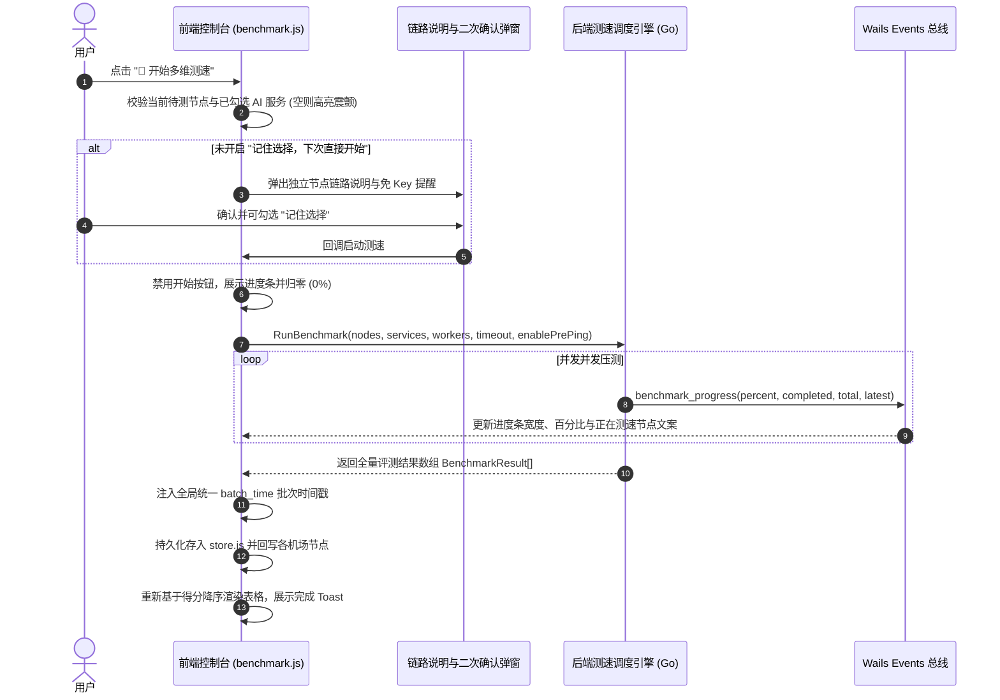

# NodePilot 前端 GUI 交互、可视化图表与诊断体系特性规约

## 一、 模块全景与 UI 架构 (Overview & Architecture)

### 1.1 核心动机与设计理念 (Why)
NodePilot 面向 AI 研发工程师与高级开发者，其前端不仅需要承载复杂的网络代理配置管理，更需要提供毫秒级、多维度、流式 AI 探针的实时可视化呈现与深度网络故障链路排查能力。
传统代理客户端前端普遍存在“逻辑死板单一”、“重依赖体积臃肿的图表库”、“配置与测速割裂”、“排障缺乏上下文”等痛点。NodePilot 前端架构遵循以下第一性原则：
1. **零第三方重型依赖 (Zero Heavy 3rd-Party Dependencies)**：不引入 Chart.js、ECharts 或大型 UI 框架运行时，核心时序走势图表采用纯原生 SVG + 贝塞尔曲线算法手工绘制，表格列宽自适应通过离屏 Canvas 毫秒级测量计算，保持极佳的冷启动性能与内存可控性；
2. **异步分片解耦与插槽挂载 (Fragment-driven Architecture)**：将复杂的抽屉 (Drawer)、模态框 (Modal) 以及偏好设置两大子面板从单体 `index.html` 剥离，通过 [fragments.js](../../app/frontend/src/js/fragments.js) 在首屏微任务中并行异步载入挂载；
3. **交互分流三元组边界 (Drawer vs Modal vs Toast)**：坚决贯彻“高密度复杂数据右侧滑出抽屉、关键确认居中紧凑对话框、系统状态浮动轻量通知”的三元组边界，杜绝界面上下文断裂；
4. **全链路状态可观测 (Full-Stack Observability)**：从前置 TCP 握手、HTTP 首包 (TTFB)、AI 首字吐字 (TTFT)、流式 TPS 速率、吐字抖动 (Jitter)、代码上行带宽 (Ingress)，到底层代理出站日志，提供由表及里的全景透视。

---

### 1.2 前端代码组织架构 (How)

```
app/frontend/src/
├── index.html                   # 主窗口骨架与主舞台挂载槽位
├── main.css                     # 模块化样式聚合入口 (@import 导入各子样式)
├── css/
│   ├── variables.css            # 深浅双主题 CSS 变量系统与调色板基准
│   ├── base.css                 # 全局基底排版与滚动条重置
│   ├── sidebar.css              # 现代侧边栏折叠/展开与多工作台路由样式
│   ├── benchmark.css            # 测速控制台、工具栏、可伸缩表格与排名徽章样式
│   ├── airports.css             # 机场与订阅管理两行式卡片与正则面板样式
│   ├── history_chart.css        # 原生 SVG 历史走势图表、十字游标与浮动 Tooltip 样式
│   ├── components.css           # 抽屉、模态弹窗、Toast 与通用表单控件
│   └── themes.css               # 浅色模式高可读性与无障碍优化覆盖样式
├── fragments/                   # 异步挂载 HTML 视图分片
│   ├── drawer_node_filter.html  # 节点正则过滤与实时预览抽屉
│   ├── drawer_nodes_list.html   # 全量节点清单多选与详情抽屉
│   ├── drawer_runtime_log.html  # 实时测试运行日志抽屉
│   ├── modal_confirm.html       # 紧凑居中二次确认弹窗
│   ├── modal_error_diag.html    # 订阅异常智能排查与重试抽屉
│   ├── modal_export.html        # 策略组与配置多格式导出对话框
│   ├── settings_probes.html     # 5 大 AI 探针规范配置面板
│   └── settings_engine.html     # 测速引擎参数与策略偏好面板
└── js/
    ├── main.js                  # 应用装配入口与生命周期协调器
    ├── sidebar.js               # 侧边栏多视图路由 (Benchmark/Airports/History/Settings)
    ├── benchmark.js             # 测速调度、Wails 事件总线推流、主表格渲染与策略导出
    ├── table_resizer.js         # 离屏 Canvas 列宽自适应、鼠标拖拽与持久化存储
    ├── metric_tooltips.js       # 指标技术深度解析字典与动态 Tooltip 注入器
    ├── history_chart.js         # 纯原生 SVG 多节点多指标时序走势图表核心引擎
    ├── vpn_exporter.js          # Clash/Mihomo/Shadowrocket 客户端规则序列化
    ├── runtime_log.js           # AIDF 实时运行日志流监听与多级色彩高亮
    ├── diag.js                  # 订阅异常特征模式匹配与就地排查控制器
    ├── theme.js                 # 亮暗双主题与原生系统窗口标题栏联动切换
    ├── store.js                 # SQLite 本地存储与 LocalStorage 双层持久化驱动
    ├── utils.js                 # HTML 转义、Toast 提示、格式化等通用工具函数
    └── i18n/                    # 纯原生零刷新国际化引擎 (zh / en)
        ├── i18n.js
        └── locales/
            ├── zh.js
            └── en.js
```

---

## 二、 评测控制台交互特性规约 (Benchmark Console)

### 2.1 多机场聚合切换与节点多选联动 (What & How)
- **源码对应**：[benchmark.js](../../app/frontend/src/js/benchmark.js)、[airport_manager.js](../../app/frontend/src/js/airport_manager.js)、[index.html](../../app/frontend/src/index.html)。
- **下拉多选组件设计**：
  - 顶部工具条采用轻量自定义下拉多选菜单 `#dropdown-airports` 与 `#dropdown-services`；
  - 点击 Trigger 按钮展开，支持一键“全选/反选”，外部空白区域点击（`document.addEventListener("click")`）自动关闭其他已展开菜单；
  - 动态 Trigger 标题：未选择时提示 `未选择 (0)`，全选时提示 `全部 (N)`，部分选择时展示 `已选 M 项`，并配合小红点或徽章高亮；
  - “一键清空选择”按钮（`#btn-clear-selection`）：点击即可一键复位机场与服务勾选状态并重渲染空态提示。
- **节点聚合与去重流**：
  - 调用 `getCurrentCombinedNodes()` 从所有勾选的机场中提取节点；
  - 经过各机场私有的“包含正则 (includeReg)”与“排除正则 (excludeReg)”流水线清洗；
  - 主界面 `#node-count-badge` 实时同步当前有效待测节点总数，点击该 Badge 即可直接滑出 [drawer_nodes_list.html](../../app/frontend/src/fragments/drawer_nodes_list.html) 抽屉查看全量待测节点明细。

---

### 2.2 自适应可拖拽列宽表格与本地持久化 (`table_resizer.js`)

#### 1. 技术动机 (Why)
不同机场节点名称长短不一（例如包含复杂国家旗帜 Emoji、协议名称、业务备注），固定列宽会导致长名称频繁截断或小屏横向溢出。

#### 2. 实现机制 (How)
- **离屏 Canvas 毫秒级免重排测量**：
  ```javascript
  // 使用离屏 Canvas 提取文本实际像素宽度，避免读取 DOM 触发重排 (Reflow)
  let measureCanvas = document.createElement("canvas");
  let measureCtx = measureCanvas.getContext("2d");
  function getTextWidth(text, font) {
      measureCtx.font = font;
      return measureCtx.measureText(text).width;
  }
  ```
- **列宽基准参数矩阵**：
  定义在 `BENCHMARK_COL_CONFIGS`，每个列包含：
  - `min`：物理最小收缩宽度（防止文字坍塌）；
  - `maxCap`：内容自适应上限（超出上限后截断并启用 CSS `text-overflow: ellipsis`，鼠标 Hover 通过 `title` 显示全称）；
  - `default`：出厂基准列宽。
- **三阶段宽度计算与拖拽**：
  1. **首屏内容自适应**：遍历表头及可见数据行，取 `maxContentWidth`，并限制在 `[min, maxCap]` 闭区间内；
  2. **高灵敏度鼠标拖拽**：表头右侧插入 `.col-resizer` 把手，在 `mousedown` 时监听全局 `mousemove`，动态调节当前 `th.style.width` 并同步更新整个表格容器宽度；
  3. **双击恢复自适应**：双击列边缘分界线触发 `ondblclick`，自 `localStorage` 中删除该列的自定义持久化记录，立即恢复依据最新内容的自适应排版；
  4. **持久化存储**：拖拽完成在 `mouseup` 时以 JSON 格式写入 `localStorage.setItem(storageKey, ...)`，应用热重启完美保持布局。

---

### 2.3 指标技术说明气泡与状态徽章渲染 (`metric_tooltips.js`)

#### 1. 指标字典架构 (What)
指标说明集中于 `METRIC_TOOLTIPS`，涵盖 9 大维度，包含：
- **权重倾向 (Weight Badge)**：一票否决项 (`veto`)、正向优化项 (`opt-high`)、负向优化项 (`opt-low`)；
- **全要素剖析**：角色定位 (`Role`)、测量必要性 (`Why`)、测量方法 (`How`)、评价导向 (`Eval`) 与 权重配比 (`Weight`)；
- **纯动态注入**：通过 `injectMetricTooltips()` 扫描 `.info-icon[data-metric]`，将预编译模板注入 DOM，消除主 HTML 近 300 行死模板。

#### 2. 排行榜状态徽章与数值梯度 (How)
| 列字段 | 渲染表现与徽章色彩 | 技术含义与交互逻辑 |
| :--- | :--- | :--- |
| **Rank** | `top1` 黄金冠、`top2` 白银盾、`top3` 青铜星、普通灰标 | 综合得分全局降序排名 |
| **机场别名** | `.airport-tag` 独立色块 | 标识该节点归属的订阅配置源 |
| **节点名称** | `.cell-ellipsis-text` 文本截断 | 悬浮显示完整节点名称 |
| **节点 Ping** | ⚡ `ping-fast` (<150ms 绿)、`ping-medium` (150~300ms 黄)、`ping-slow` (>300ms 橙)、`ping-fail` (红/离线) | 前置轻量 TCP/ICMP 握手时延 |
| **服务可用性** | `.status-avail` (绿) / `.status-unavail` (红) | 目标 AI 服务网关可达性与鉴权有效性 |
| **TTFB / TTFT** | 毫秒数值或 `< 1ms`，未测展示 `-` | 连接建立首包与首个 Token 吐字时延 |
| **TPS 速率** | 浮点数值 (如 `24.5 TPS`)，免 Key 探测显示 `N/A` | 流式连续吐字吞吐速率 |
| **Jitter 抖动** | 毫秒数值或 `N/A`；若检测到缓冲劫持附加 `⚠️ 缓冲劫持 (Jitter偏高)` | 吐字时间间隔方差与中间代理拼包告警 |
| **Ingress 上行** | `X.XX MB/s (XX.X M)` 双单位展示 | 上行代码/Payload 真实吞吐能力 |
| **综合得分** | `.score-box` (`score-great` ≥80, `score-good` ≥60, `score-pass` ≥40, `score-bad` <40) | 全维度标准化加权总评 (0~100) |

---

### 2.4 评测任务生命周期与独立链路保障 (`benchmark.js`)



---

## 三、 历史趋势可视化系统规约 (History Chart Visualization)

### 3.1 核心设计与数据架构 (What)
- **源码对应**：[history_chart.js](../../app/frontend/src/js/history_chart.js)、[history_chart.css](../../app/frontend/src/css/history_chart.css)。
- **设计初衷**：长效评估各机场在不同时段的 QoS 稳定性。单纯单次测速受瞬时网络波动影响大，通过历史时序折线图可快速捕获节点降速、断流、抖动劣化的拐点。
- **核心数据要素 (5 大基石)**：`airport_name`、`node_name`、`service_name`、`metric`、`tested_at`（或批次时间 `batch_time`）。

---

### 3.2 批次时间窗口对齐算法 (Session Batch Alignment) (How)
在真实测速中，不同节点完成测速的时间存在秒级差异。若直接以单个节点的绝对完成时间点作为 X 轴坐标，不同节点将在 X 轴形成错位离散孤立点，无法形成垂直对比。
NodePilot 实现了 **120 秒时间滑窗聚合算法**：
```javascript
function clusterIntoBenchmarkSessions(records) {
    // 1. 按时间升序排序
    const sorted = records.slice().sort((a, b) => getTs(a) - getTs(b));
    const sessions = [];
    let cur = null;
    const SESSION_WINDOW_MS = 120 * 1000; // 2 分钟批次滑窗

    sorted.forEach(r => {
        const t = getTs(r);
        if (!cur) {
            cur = { timestamp: t, records: [r], sessionKey: getDisplayTime(r) };
        } else {
            const lastR = cur.records[cur.records.length - 1];
            const sameExplicitBatch = r.batch_time && r.batch_time === lastR.batch_time;
            if (sameExplicitBatch || (t - getTs(lastR) <= SESSION_WINDOW_MS)) {
                cur.records.push(r);
            } else {
                sessions.push(cur);
                cur = { timestamp: t, records: [r], sessionKey: getDisplayTime(r) };
            }
        }
    });
    if (cur) sessions.push(cur);
    return sessions;
}
```
- **双模时间对齐切换**：
  - `raw` (默认)：按单节点完成时间独立打点；
  - `batch`：按滑窗或统一 `batch_time` 归集，使同批次测试的多节点在同一垂直时间参考线上对齐。

---

### 3.3 原生 SVG 图表渲染与交互特性

#### 1. 贝塞尔三次平滑曲线 (Cubic Bezier Spline)
折线拐点处采用平滑插值，避免尖锐折角，保证高美观度与视觉连贯性：
```javascript
let pathD = `M ${pts[0].x} ${pts[0].y}`;
for (let i = 0; i < pts.length - 1; i++) {
    const p0 = pts[i];
    const p1 = pts[i + 1];
    const dx = (p1.x - p0.x) * 0.35; // 平滑曲率常数
    pathD += ` C ${p0.x + dx} ${p0.y}, ${p1.x - dx} ${p1.y}, ${p1.x} ${p1.y}`;
}
```

#### 2. 多维度指标联动与双 Y 轴自适应 (Dual Y-Axis)
- 支持单选与多选指标维度（综合得分、节点 Ping、首字时延 TTFT、流式速度 TPS、连接时延 TTFB）；
- 选中两项指标时自动启用**双 Y 轴呈现**：
  - **左轴 (Primary)**：主指标（如综合得分，实线曲线，实心标记点）；
  - **右轴 (Secondary)**：副指标（如节点 Ping，虚线 `stroke-dasharray="5 3"`，空心标记点）；
- 各轴极值采用防抖扩展算法：`yMin = Math.max(0, Math.floor(minV * 0.85))`，`yMax = Math.ceil(maxV * 1.15)`，固定区间指标（如得分 0~100）强制固定范围。

#### 3. 极性方向指示器 (Polarity Direction Badges)
- 自动为每个数据点和轴标签打上极性标记：
  - **越高越好 (↑ 优)**：综合得分、TPS 速率；数据点采用**向上三角形 (`▲`)**；
  - **越低越好 (↓ 优)**：Ping 时延、TTFB、TTFT、Jitter；数据点采用**向下三角形 (`▼`)**；
  - Tooltip 悬浮框中同步标注 `↑ 优` 或 `↓ 优`，彻底规避用户误读。

#### 4. 矩阵色彩分配体系 (Matrix Palette)
- 包含 18 种高对比度、无障碍调色板色彩；
- **单实体 × 多指标**：优先采用指标语义固定色（综合得分=翡翠绿，Ping=天空蓝，TTFT=极光紫，TPS=琥珀金，TTFB=珊瑚粉）；
- **多实体 × 单指标**：依实体分配独立高辨识度色彩；
- **多实体 × 多指标**：二维矩阵交织分配，杜绝全部曲线坍塌为同一种颜色。

#### 5. 动态图例交互 (Interactive Legend)
- **点击图例 Pill**：切换该曲线的隐藏/显示（Mute/Unmute）；
- **点击图例右侧 `×` 号**：从当前走势图表中物理剔除该节点曲线（不影响底层数据库存储），上方摘要显示 `已手动排除 K 项`；
- **幽灵药丸 (Ghost Pills)**：已剔除节点展示为虚线加号标签，点击单个标签可单独恢复，点击 `恢复全部 (Restore All)` 可一键复原。

#### 6. 十字游标与悬浮窗 (Crosshair & Floating Tooltip)
- 透明交互热区 `#history-chart-hitbox` 捕获鼠标移动，依据当前 X 坐标快速二分匹配最近时间采样点；
- 垂直参考线 `#history-chart-crosshair` 准确定位，对应时间点的所有数据点高亮放大；
- 浮动 Tooltip 智能计算右边界与容器边界，超出自动镜像翻转至左侧显示，避免超出视口。

---

## 四、 代理与规则配置导出体系 (VPN Exporter)

### 4.1 导出矩阵与配置格式 (What)
NodePilot 内置全功能配置导出引擎，覆盖现代全平台代理客户端：
1. **Clash / Mihomo 优选配置 (YAML)**：生成包含所有选定代理、自动测速策略组与 AI 专用分流规则的完整可导入配置文件；
2. **Shadowrocket (小火箭) 单节点 URI**：支持每行一条的明文标准协议链接清单；
3. **通用 Base64 订阅编码串**：将所有节点 URI 编码为通用客户端可一键导入的订阅内容；
4. **Markdown 评测报告**：适合在技术社区、GitHub 或团队知识库中归档分享。

---

### 4.2 协议 URI 序列化生成矩阵 (How)
位于 [vpn_exporter.js](../../app/frontend/src/js/vpn_exporter.js) 的 `generateShadowrocketURIs(nodes)`：
- **Hysteria2 (Hy2)**：`hysteria2://{auth}@{server}:{port}/?sni={sni}&insecure={insecure}#{name}`；
- **Trojan**：`trojan://{password}@{server}:{port}?sni={sni}&allowInsecure={insecure}#{name}`；
- **Shadowsocks (SS)**：`ss://{base64(cipher:password)}@{server}:{port}#{name}`；
- **VMess**：构造 VMess V2 规范 JSON 对象并经过 Base64 序列化为 `vmess://{b64}`；
- **VLESS / AnyTLS**：`vless://{uuid}@{server}:{port}?security={tls/none}&sni={sni}#{name}`。

---

### 4.3 智能分流规则组与后端 Top-N 优选配置

#### 1. 前端完整配置生成 (`generateClashYAML`)
- 生成标准的 `port: 7890`、`socks-port: 7891`、`mode: rule`；
- **自动测速策略组 (`url-test`)**：
  ```yaml
  proxy-groups:
    - name: "⚡ 优选节点-自动选优"
      type: url-test
      url: http://www.gstatic.com/generate_204
      interval: 300
      tolerance: 50
      proxies:
        - "Node-A"
        - "Node-B"
  ```
- **智能分流策略组 (`select`)**：包含自动选优、各节点直选与 DIRECT；
- **AI 专属规则集 (`rules`)**：
  ```yaml
  rules:
    - DOMAIN-SUFFIX,googleapis.com,PROXY
    - DOMAIN-SUFFIX,openai.com,PROXY
    - DOMAIN-SUFFIX,anthropic.com,PROXY
    - DOMAIN-SUFFIX,cursor.sh,PROXY
    - MATCH,PROXY
  ```

#### 2. 后端 Top-N 故障转移策略组生成 (`engine/pkg/exporter/clash.go`)
- 函数 `GenerateBestGroupsYAML(results, topN)`：
  - 自动识别评测中各服务排名前 N 的最佳节点；
  - 根据服务类型自动嗅探探针真实端点（如 Google Antigravity -> `https://cloudcode-pa.googleapis.com`，Anthropic -> `https://api.anthropic.com/v1/messages`）；
  - 输出 `fallback` 故障转移策略组 YAML 文本。

---

## 五、 实时日志与错误诊断系统 (Diagnostics & Runtime Logs)

### 5.1 抽屉式实时日志查看器 (`runtime_log.js`)
- **UI 挂载**：[drawer_runtime_log.html](../../app/frontend/src/fragments/drawer_runtime_log.html)，采用 760px 宽度的右侧滑出抽屉；
- **多级语法高亮流**：
  - `[ERROR]`：鲜红色高亮加粗 (`#f87171`)；
  - `[WARN]`：明黄色高亮 (`#fbbf24`)；
  - `[INFO]`：淡灰色正常显示，包含 `SUCCESS` 则呈现鲜亮翠绿 (`#4ade80`)；
  - `[DEBUG]`：极光亮紫 (`#a855f7`)；
- **控制与协同特性**：
  - **自动滚到底部 (Auto-scroll)**：勾选后最新追加日志自动保持滚动条位于底部；
  - **一键复制全部 (Copy All)**：将底层完整日志原始纯文本写入剪贴板；
  - **复制文件路径 (Copy Path)**：快速复制日志文件的绝对磁盘路径；
  - **系统文件管理器打开 (Open Log Dir)**：调用 Wails 后端 `window.go.main.App.OpenLogDir()`，一键在 macOS Finder 或 Windows 资源管理器中弹出定位日志文件夹；
  - **动态日志级别调整**：在偏好设置中切换日志级别（DEBUG/INFO/WARN/ERROR），实时调用后端的 `SetLogLevel()` 并持久化保存。

---

### 5.2 订阅异常模式匹配与就地排查控制器 (`diag.js`)

#### 1. 订阅 URL 前置校验规则
- 非空校验；
- 协议头校验（必须以 `http://` 或 `https://` 开头）；
- 域名结构与格式校验（防空格与截断乱码）。

#### 2. 故障特征诊断知识图谱 (Diagnostic Heuristic Matrix)
| 异常特征匹配 (正则/关键词) | 诊断标题 | 排查建议与处理对策 |
| :--- | :--- | :--- |
| `403` / `forbidden` | 🚫 HTTP 403 权限拒绝 | 订阅可能过期、流量耗尽或 Token 参数被截断。建议登录官网重新复制完整链接。 |
| `401` / `unauthorized` | 🔒 HTTP 401 密钥失效 | 订阅授权凭证或重置后的 Token 已失效。需在官网重新生成。 |
| `404` / `not found` | 🔍 HTTP 404 资源未找到 | 订阅地址不存在。核对域名与路由路径是否遗漏字符。 |
| `500` / `502` / `503` / `504` | 💥 HTTP 5xx 机场服务端故障 | 机场下发网关维护或宕机。请稍后重试或查看官方公告。 |
| `timeout` / `deadline exceeded` | ⏳ 网络连接超时 | 连接订阅服务器超时，国内访问可能受阻。建议开启前置代理后再试。 |
| `no such host` / `lookup` | 🌐 DNS 解析失败 | 无法解析订阅域名。检查域名拼写或更换系统 DNS 为 1.1.1.1/8.8.8.8。 |
| `未能解析出` / `0 个` / `empty` | 📄 节点解析为空 | 成功下载但未发现有效代理协议。链接可能为网页预览而非 Clash/Mihomo 订阅。 |
| 其他错误 | ⚠️ 订阅拉取或解析异常 | 未知异常。建议在浏览器中直接访问该 URL 核验内容。 |

#### 3. 闭环处置闭环
弹窗右侧提供：
- `✏️ 修改订阅链接`：自动跳转至“✈️ 机场与订阅”工作台并聚焦该机场编辑表单；
- `🔄 重试加载`：关闭弹窗并就地重新发起一次网络抓取与解析。

---

## 六、 界面规范、主题与国际化体系 (Design System, Themes & i18n)

### 6.1 抽屉 (Drawer) 与 对话框 (Dialog) 交互分流架构
依据本项目全局 UI 规范，界面的空间层级严格分流：

```
                ┌────────────────────────────────────────┐
                │          用户交互与内容请求             │
                └───────────────────┬────────────────────┘
                                    │
            ┌───────────────────────┴───────────────────────┐
            ▼                                               ▼
  【高信息密度 / 需纵向深度】                     【低信息量 / 确认与简短操作】
  - 节点详情列表 (drawer_nodes_list)              - 删除机场二次确认 (modal_confirm)
  - 包含/排除正则配置 (drawer_node_filter)         - 清空历史评测确认 (modal_confirm)
  - 实时测试运行日志 (drawer_runtime_log)          - 独立链路测速说明提示 (modal_confirm)
  - 订阅故障分析与建议 (modal_error_diag)         - 策略组配置导出 (modal_export)
            │                                               │
            ▼                                               ▼
┌───────────────────────────────┐               ┌───────────────────────────────┐
│     右侧滑出抽屉 (Drawer)      │               │     居中紧凑对话框 (Modal)     │
│ - 宽度 560px ~ 760px          │               │ - 宽度 420px ~ 480px          │
│ - 占满 100% 垂直高度          │               │ - 屏幕绝对居中浮动            │
│ - 右上角 × 按钮，蒙层点击关闭   │               │ - 高信息密度纯文本，确认/取消 │
└───────────────────────────────┘               └───────────────────────────────┘
```

---

### 6.2 亮暗双主题与 CSS 变量架构 (`theme.js`, `variables.css`)

#### 1. 调色板与语义变量设计
- **深色主题 (Dark - 深邃雷达座舱)**：
  - 背景：`--bg-dark: #070d18`，卡片：`--bg-card: #0f172a`；
  - 文本：`--text-primary: #f8fafc`，副文本：`--text-secondary: #94a3b8`；
  - 品牌高光：翡翠绿 `#10b981` 与 极光冰蓝 `#0ea5e9` 形成渐变。
- **浅色主题 (Light - 冰川白与海蓝经纬质感)**：
  - 背景：`--bg-dark: #f0f4f9`，卡片：`--bg-card: #ffffff`；
  - 文本：`--text-primary: #0f172a`（高对比深蓝灰）；
  - 全套覆盖：Tooltip 白底高投影，表格边框与徽章色彩增强，确保高反光环境下文字极其锐利。
- **三段式切换与系统联动**：
  - 支持 `auto` (跟随系统)、`light`、`dark`；
  - 监听 `window.matchMedia("(prefers-color-scheme: dark)")`，在 auto 模式下操作系统深浅变化实时无缝响应；
  - 通过 `window.go.main.App.SetNativeTheme(resolved)` 动态同步 macOS/Windows 原生窗口标题栏深浅底色。

---

### 6.3 纯轻量原生国际化体系 (`i18n.js`)

#### 1. 架构特性 (How)
- **零刷新动态切换 (Zero-Reload)**：改变语言无需刷新页面或重新初始化 Wails 运行时上下文；
- **语言探测与回退链**：用户设定优先 -> 系统环境语言探测 (`detectSystemLanguage()`) -> `zh` -> 最终回退至 `en`；
- **声明式 DOM 翻译标注**：
  - `data-i18n="key"`：更新元素的 `innerText`；
  - `data-i18n-title="key"`：更新元素的 `title` 属性；
  - `data-i18n-placeholder="key"`：更新输入框的 `placeholder`；
- **参数插值与广播**：
  - `t("sidebar.ready_status", { nodes: 15 }, "已就绪: {nodes} 节点")` 自动将 `{nodes}` 替换为实际入参；
  - `onLanguageChange(callback)` 注册组件自适应观察者，切换语言时自动重绘图表、表格与表头 Tooltip。

---

## 七、 边界条件与测试固化验收断言 (Edge Cases & Verification Assertions)

为了杜绝后续重构造成功能特性或视觉行为漂移，特固化以下验收测试要求：

### 7.1 评测控制台与表格测试断言
1. **空态防御验证**：
   - 当没有勾选任何机场或所有节点被规则排除时，主表格体必须输出带有 `colspan="11"` 的居中空态提示，严禁抛出 JS 未捕获异常；
   - 点击“开始多维测速”时，若未选机场或未选服务，对应的下拉触发器必须被施加 `.highlight-pulse` 震颤动画，并弹出 warning 级别的 Toast 告警。
2. **免 Key 探测防误报断言**：
   - 当待测服务未在偏好设置中配置 API Key 时，表格的 TPS 与 Jitter 单元格必须渲染为灰色的 `N/A`；
   - 严禁在 Jitter 为 `N/A` 或 `0ms` 时触发 `⚠️ 缓冲劫持 (Jitter偏高)` 告警，缓冲告警触发条件必须同时满足 `isAvail && (jitter > 150ms || (proxy_buffer_detected && jitter > 5.0ms))`。
3. **表格列宽拖拽与持久化断言**：
   - 拖拽任意列宽至新像素（如 300px），刷新页面后该列宽必须精准恢复为 300px；
   - 双击该列 `.col-resizer` 分界线后，`localStorage` 中的持久化 key 必须被移除，且列宽立即依据当前数据内容宽度自适应重算并施加 `[min, maxCap]` 限制。

---

### 7.2 历史趋势图表测试断言
1. **批次对齐准确性断言**：
   - 包含多条相隔 10 秒完成的测速记录，在 `activeTimeMode = "batch"` 模式下，必须被聚合至同一次 `sessionKey` 下，且 X 轴必须只产生一个对齐的时间刻度；
   - 在 `raw` 模式下，各节点必须保留其各自独立的完成时间刻度。
2. **多选指标双 Y 轴断言**：
   - 当用户选中 1 项指标时，图表仅绘制左侧 Y 轴与网格；
   - 当用户选中 2 项指标时（例如综合得分与 Ping），图表右侧必须准确渲染次轴坐标、刻度标签与辅助虚线曲线，顶部左侧与右侧必须分别标出 `[左轴] 指标名 (极性)` 与 `[右轴] 指标名 (极性)`；
   - 当用户尝试取消勾选最后一项指标时，该操作必须被拒绝，确保图表始终至少激活一项指标。
3. **动态图例剔除与恢复断言**：
   - 点击图例的 `×` 号剔除一个节点序列后，该曲线必须立即从 SVG 中移除，顶部摘要必须追加显示 `已手动排除 1 项`，图例区域必须出现对应的幽灵加号药丸；
   - 点击“恢复全部”按钮后，所有被剔除的节点必须一次性无损重绘回到 SVG 画布中。
4. **单实体多指标色彩防塌缩断言**：
   - 当图表中仅含 1 个机场或 1 个实体、但勾选了 3 项指标时，矩阵色彩分配器必须按照 `METRIC_SEMANTIC_COLORS` 为各指标分配语义差异色，严禁全部渲染为同一种默认翡翠绿。

---

### 7.3 配置导出与排障诊断断言
1. **协议 URI 完整性断言**：
   - 导出 Hysteria2 节点时，URI 必须显式携带 `?sni=...&insecure=...` 参数与 `#name` 锚点；
   - 导出 SS 节点时，密钥部分必须符合 RFC 标准 Base64 编码规范。
2. **订阅排查知识库断言**：
   - 当后端返回包含 `403` 或 `Forbidden` 文本的错误时，`analyzeSubscriptionError` 返回的标题必须为 `🚫 HTTP 403 权限拒绝 (Forbidden)`，建议内容必须包含重新复制 Clash/Mihomo 订阅的引导。
3. **运行时日志链路断言**：
   - 打开日志抽屉必须正确读取后端日志路径；
   - 包含 `[ERROR]` 的日志行必须以 `#f87171` 渲染，勾选“自动滚到底部”时容器 `scrollTop` 必须等于 `scrollHeight`。

---

### 7.4 国际化与主题测试断言
1. **Zero-Reload 语言切换断言**：
   - 切换语言至 English 时，页面所有带有 `data-i18n` 的 DOM 节点、表头 Tooltip 气泡、历史图表坐标轴与侧边栏计数描述必须在当前界面就地完成语言替换，不触发页面重载；
   - 缺少当前语言键名时，必须平滑回退至英文或默认 fallback 文本，不得出现 `undefined`。
2. **主题与原生系统联动断言**：
   - 切换主题模式时，`document.documentElement` 的 `data-theme` 属性必须精确置为 `dark` 或 `light`；
   - 若处于 `auto` 模式，在模拟系统深浅偏好切换时，页面颜色必须即时联动变换。
