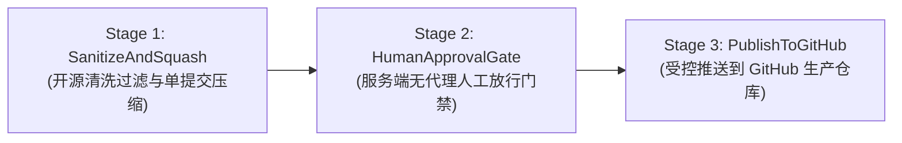

# NodePilot 命令行引擎、跨平台构建与发布流水线特性规约 (CLI Engine, Cross-Platform Build & CI/CD Release Specification)

## 一、 功能背景与第一性原理动机 (Overview & Motivation - Why)

### 1.1 业务背景与无头环境痛点
在主流 AI 辅助编程与 AI IDE（如 Google Antigravity、Cursor、Windsurf、GitHub Copilot、Claude Code 等）的重度开发场景中，高质量海外代理/VPN 节点是保障开发者连贯体验的生命线。然而，在实际工程与自动化运维体系中，单纯依赖桌面端图形界面（GUI）存在显著局限与断层：

1. **无头服务器与容器化环境无法运行 GUI**：
   - 开发者常需在远程 VPS、无 GUI 绑定的 Linux 开发机、Docker 容器或远程云主机上运行大模型推理、代码辅助工具或定时自动化爬取/评测任务；
   - 传统 GUI 桌面应用强依赖图形视窗服务（macOS WindowServer, Windows DWM, Linux X11/Wayland），无法直接在 SSH 远程终端或无头环境中执行，迫使开发者脱离真实运行环境在本地测速。
2. **自动化脚本与代理内核协同断层**：
   - 开发者需要自动化评测能力：例如每日定时跑批评测数十个机场节点，并将评分最高的 Top 节点自动导出为 Clash/Mihomo 的策略组配置文件，或推送到软路由与服务器端代理客户端中；
   - GUI 工具难以被 Shell、Python 脚本或 Cron 定时任务调用，缺乏纯净的标准输入输出（StdIO）、结构化退出状态码（Exit Code）以及机器可读的配置生成接口。
3. **多平台桌面构建环境强宿主绑定与跨编译壁垒**：
   - Wails 桌面框架基于系统原生 WebView（macOS WebKit、Windows WebView2、Linux WebKitGTK 4.0/4.1）。在单一宿主机上直接跨平台构建 GUI 应用极其困难（例如在 macOS 上无法直接通过普通链接器生成依赖 WebKitGTK 动态库的 Linux GUI 二进制）；
   - 若缺乏灵活的多平台统一调度与降级机制，开发者的本地构建流水线极易因系统环境差异直接报错中断。
4. **开源持续交付中的隐私与痕迹污染隐患**：
   - 在现代 AI 辅助研发流程中，工程目录下常驻大量的思考日志（`logs/`）、内部需求分析与私有开发草稿（`docs/require/`, `docs/doing/`）；
   - 若直接将内部开发仓库推送到 GitHub 开源仓库，不仅会导致内部私有信息泄露，而且琐碎无序的内部 Commit 历史严重破坏了开源软件工程的专业性与纯净度；
   - 必须在发布流水线中引入强约束的安全清洗过滤机制、历史 Commit 压缩机制（Squash into 1 clean commit）以及人工放行审核门禁。

### 1.2 NodePilot 第一性原理解决体系
针对上述痛点，NodePilot 构建了 **“GUI 与无头 CLI 双轨解耦、零外部依赖纯静态交叉编译、一键自适应多平台打包与工业级受控 CI/CD 发布”** 的完整工程体系：

- **双轨分流架构 (Dual-Track Architecture)**：GUI 桌面端（Wails）与 CLI 命令行引擎（Cobra）在应用层解耦，底层共享完全一致的节点解析、并发网络探针调度与加权评分核心库 (`engine/pkg/`)；
- **全参数无头 CLI 引擎 (Headless CLI Engine)**：支持本地 YAML 配置 (`-c`)、远程订阅 (`-u`)、直连基准对照 (`--direct`)、目标 AI 服务过滤 (`-s`)、自定义 YAML 探针加载 (`-p`)，并提供终端自适应 ASCII 表格、Markdown 报告 (`-m`) 与 Clash 优选策略组 (`-o`) 自动导出能力；
- **纯静态交叉编译矩阵 (Static Cross-Compilation Matrix)**：通过 `CGO_ENABLED=0` 静态编译三大操作系统四大核心架构（`darwin-arm64`, `darwin-amd64`, `linux-amd64`, `windows-amd64.exe`）的独立 CLI 引擎，彻底消除 C 动态库依赖，实现无头服务器开箱即用；
- **自适应一键本地构建流水线 (`build.sh`)**：支持交互式菜单与命令行无头分发，内置 macOS Universal DMG 打包（含 `/Applications` 替身挂载）、Windows 64位构建、Linux WebKitGTK 优先编译及非 Linux 宿主智能 CLI 降级；
- **AIDF 标准持续集成与受控交付 (Azure Pipelines CI/CD)**：
  - `desktop-ci.yml`：手动按需触发，运行期双阶段动态版本号注入 (`YYMMDDRR`)，执行底层引擎单元测试与多平台并行 Matrix 桌面产物归档；
  - `staging-sync-cd.yml` 与 `github-publish-cd.yml`：两阶段解耦开源发布持续交付体系（内部脱敏单提交暂存 ➔ 中间库人工审计 ➔ 受控对等推送）；
  - `sync-github.sh`：本地一键代码脱敏清洗与开源镜像同步工具；
  - `.github/workflows/`：开源社区 GitHub Actions 门禁（`ci.yml` 质量门禁 + `release.yml` 多平台构建与人工确认发布）。

---

## 二、 核心架构模型与参数契约 (Architecture & Data Contracts - What)

### 2.1 体系全景与分流矩阵

```
┌─────────────────────────────────────────────────────────────────────────────────────────┐
│                                   NodePilot 双轨执行架构                                 │
├─────────────────────────────────────────┬───────────────────────────────────────────────┤
│         桌面图形应用 (GUI Desktop App)   │            无头命令行引擎 (Headless CLI Engine) │
│  ┌───────────────────────────────────┐  │  ┌─────────────────────────────────────────┐  │
│  │ Wails 运行时 (main.go / app.go)    │  │  │ Cobra 命令行接口 (engine/cmd/root.go)   │  │
│  │ Webview 视窗 / 双语 / 历史折线图  │  │  │ 标准输入输出 / ASCII 表格 / 退出码状态机 │  │
│  └─────────────────┬─────────────────┘  │  └────────────────────┬────────────────────┘  │
└────────────────────┼────────────────────┴───────────────────────┼───────────────────────┘
                     │                                            │
                     ▼                                            ▼
┌─────────────────────────────────────────────────────────────────────────────────────────┐
│                             共享评测核心库 (engine/pkg/)                                 │
│  ┌─────────────────────┐  ┌─────────────────────┐  ┌─────────────────────────────────┐  │
│  │ 节点解析 (parser)   │  │ 探针调度 (runner)   │  │ 结果导出 (exporter)             │  │
│  │ Clash/Base64/URL    │  │ httptrace 并发工作池 │  │ 终端 ASCII 表格 / MD 报告 / YAML │  │
│  └─────────────────────┘  └─────────────────────┘  └─────────────────────────────────┘  │
│  ┌─────────────────────┐  ┌─────────────────────┐  ┌─────────────────────────────────┐  │
│  │ 服务探针 (probe)    │  │ 评分加权 (scorer)   │  │ 统一领域模型 (model)            │  │
│  │ 5大官方 / 自定义YAML│  │ 动态多维 / 缓冲降权 │  │ Node / BenchmarkResult / Metrics│  │
│  └─────────────────────┘  └─────────────────────┘  └─────────────────────────────────┘  │
└─────────────────────────────────────────────────────────────────────────────────────────┘
                                             ▲
                                             │ 驱动构建与打包
┌────────────────────────────────────────────┴────────────────────────────────────────────┐
│                             统一构建与交付流水线 (Build & CI/CD)                         │
│  ┌───────────────────────────────────────────────────────────────────────────────────┐  │
│  │ 一键构建调度脚本 (build.sh)                                                       │  │
│  │  ├─ [0] 全部桌面端生成 (macOS Universal DMG + Windows EXE + Linux 原生桌面端)     │  │
│  │  ├─ [1] macOS 桌面端 (NodePilot.app & NodePilot-macOS-Universal.dmg)              │  │
│  │  ├─ [2] Windows 桌面端 (NodePilot.exe)                                            │  │
│  │  ├─ [3] Linux 桌面端 (WebKitGTK 4.1 原生桌面端 / 宿主机环境缺失时平滑降级为 CLI)   │  │
│  │  └─ [4] 跨平台 CLI 静态核心矩阵 (darwin-arm64, darwin-amd64, linux-amd64, win.exe)│  │
│  └───────────────────────────────────────────────────────────────────────────────────┘  │
│  ┌──────────────────────────────────────┐  ┌─────────────────────────────────────────┐  │
│  │ 桌面端持续集成 (desktop-ci.yml)       │  │ GitHub 开源持续交付 (github-release-cd) │  │
│  │  ├─ Manual Trigger Only (禁用自动)   │  │  ├─ Stage 1: 安全清洗过滤 + 单提交压缩  │  │
│  │  ├─ Phase 2 动态版本注入 (YYMMDDRR)  │  │  ├─ Stage 2: 服务端人工审核放行门禁      │  │
│  │  ├─ 引擎单元测试门禁 (go test -v)    │  │  └─ Stage 3: 受控 git push --force /     │  │
│  │  └─ 多平台产物归档 (macOS/Win/Linux) │  │            Dry Run 演练测试              │  │
│  └──────────────────────────────────────┘  └─────────────────────────────────────────┘  │
└─────────────────────────────────────────────────────────────────────────────────────────┘
```

### 2.2 CLI 命令行参数与标志契约 (Command-Line Flags)

源码实现位置：[root.go](../../engine/cmd/root.go)

| 参数标志 (Long) | 短别名 (Short) | 类型 | 默认值 | 作用与业务语义说明 |
| :--- | :---: | :---: | :---: | :--- |
| `--config` | `-c` | `string` | `""` | 本地 Clash/Mihomo 配置文件路径 (YAML 格式)，优先解析其中定义的代理节点 |
| `--url` | `-u` | `string` | `""` | 远程代理订阅链接 URL，通过 HTTP/HTTPS 自动拉取并反序列化节点 |
| `--service` | `-s` | `string` | `"all"` | 目标 AI 服务过滤，支持 `all`、`antigravity`、`gemini`、`openai`、`claude`、`cursor`（大小写模糊匹配） |
| `--profile` | `-p` | `string` | `""` | 外部自定义 AI 探针配置文件路径 (YAML 格式)，可灵活挂载自定义探针追加至评测列表 |
| `--workers` | `-w` | `int` | `5` | 并发 Worker 协程池数量，控制并发测速的线程压力 |
| `--timeout` | `-t` | `int` | `10` | 单次探测超时时间（秒），作用于 DNS 解析、TCP 握手、TLS 握手及首包响应生命周期 |
| `--output-clash` | `-o` | `string` | `""` | 导出优选策略组 YAML 文件路径，自动提取各 AI 服务 Top-5 节点生成 Fallback 策略组 |
| `--output-md` | `-m` | `string` | `""` | 导出评测报告 Markdown 文件路径，将评测综合排名与八维核心指标持久化到指定文档 |
| `--direct` | - | `bool` | `false` | 仅使用本地网络直连做基准对照测试，生成名为 `Local-Direct` 的直连基准节点 |

#### 默认兜底机制
若用户既未指定 `--config`、`--url`，亦未指定 `--direct`，CLI 引擎**绝不报错退出**，而是自动打印指引并默认注入一个 `Local-Direct` 直连探针作为开箱即用快速体验基线，确保零参数运行体验平滑：
```bash
ℹ️ No configuration file or subscription URL specified, using [Local-Direct] as baseline probe.
```

### 2.3 产物规约与目录拓扑 (`release/`)

构建系统统一将产物归档于根目录下的 `release/`，其物理拓扑与架构规范如下：

```
release/
├── macos/
│   ├── NodePilot.app/                          # macOS 原生应用 Bundle (支持 Universal 双架构)
│   │   └── Contents/
│   │       ├── Info.plist
│   │       ├── MacOS/NodePilot                 # 通用二进制 (x86_64 + arm64) 或原生二进制
│   │       ├── Resources/iconfile.icns         # 原生应用图标
│   │       └── _CodeSignature/CodeResources    # 基础代码签名资源
│   └── NodePilot-macOS-Universal.dmg           # UDZO 压缩格式的标准拖拽安装 DMG 镜像 (含 /Applications 替身)
├── windows/
│   └── NodePilot.exe                           # Windows 64-bit 独立执行程序 (内嵌 WebView2 交互)
├── linux/
│   ├── NodePilot                               # Linux 原生桌面端程序 (基于 WebKitGTK 4.1 动态库)
│   └── nodepilot-linux-amd64                   # 非 Linux 宿主机跨系统构建时生成的静态 Linux CLI 引擎 (平滑降级产物)
└── cli/
    ├── nodepilot-cli-darwin-arm64              # macOS Apple Silicon (M系列芯片) 纯静态命令行工具
    ├── nodepilot-cli-darwin-amd64              # macOS Intel (x86_64) 纯静态命令行工具
    ├── nodepilot-cli-windows-amd64.exe         # Windows 64-bit 纯静态命令行工具
    └── nodepilot-cli-linux-amd64               # Linux x86_64 纯静态命令行工具 (服务器/容器首选)
```

### 2.4 Clash 策略组导出契约与结构模型

源码定义位置：[clash.go](../../engine/pkg/exporter/clash.go)

导出的 Clash 策略组结构遵循 Clash/Mihomo 工业级标准：

```go
type ClashProxyGroup struct {
    Name     string   `yaml:"name"`              // 策略组名称，格式："⚡ <ServiceName>-Best"
    Type     string   `yaml:"type"`              // 策略组类型，强制为 "fallback" (故障自动转移)
    Proxies  []string `yaml:"proxies"`           // 评测排名前 Top-N (默认 5) 的节点名称切片
    URL      string   `yaml:"url,omitempty"`     // 各 AI 服务推导出的健康检查探活端点
    Interval int      `yaml:"interval,omitempty"`// 健康探测轮询周期 (秒，默认 300)
}

type ClashExportConfig struct {
    ProxyGroups []ClashProxyGroup `yaml:"proxy-groups"`
}
```

#### 端点自适应推导算法 (`guessEndpoint`)
根据评测的服务名称，自动映射为官方轻量连通性检查端点：
- **Google Antigravity**: `https://cloudcode-pa.googleapis.com`
- **Google Gemini**: `https://generativelanguage.googleapis.com`
- **OpenAI**: `https://api.openai.com/v1/models`
- **Anthropic Claude**: `https://api.anthropic.com/v1/messages`
- **兜底通用端点**: `https://www.google.com/generate_204`

---

## 三、 关键子系统与实现机制 (Subsystems & Implementations - How)

### 3.1 独立无头 CLI 引擎 (Headless CLI Engine)

#### 3.1.1 Cobra CLI 生命周期与异常流转
CLI 引擎以 `github.com/spf13/cobra` 作为命令树内核：
1. **执行入口**：`engine/main.go` 调用 `cmd.Execute()`；
2. **Flags 初始化**：在 `cmd/root.go` 的 `init()` 中注册所有长短标志及默认值；
3. **前置校验与短路判定**：
   - 若校验到无有效节点，返回 `fmt.Errorf("no valid nodes found to benchmark")` 并由 Cobra 截获，最终通过 `os.Exit(1)` 退出；
   - 运行正常完成则退出码为 `0`，可直接融入 Shell 管道与 CI 自动化脚本。

#### 3.1.2 节点源智能解析流
CLI 根据输入参数按优先级裁决节点来源：
- 若 `--direct` 为 `true`：立即短路，仅注入 `Local-Direct` 单节点；
- 若 `--config` 非空：调用 `parser.ParseClashFromFile(configFile)` 解构本地 YAML 节点；
- 若 `--url` 非空：调用 `parser.ParseClashFromURL(subscribeURL)` 发起 HTTP GET 请求获取远程订阅并解析；
- 若均为空：自动输出提示信息，并追加 `Local-Direct` 单节点。

#### 3.1.3 探针服务动态过滤与 Profile 扩展
通过 `selectProfiles(serviceFilter)` 实现模糊过滤匹配：
- 默认输入 `all` 或空字符串：加载全部内置探针 (`probe.DefaultProfiles()`)；
- 输入特定服务标识（如 `antigravity`, `openai`）：按 `strings.Contains` 模糊比对探针 `ID` 或 `Name`；若过滤无任何匹配，自动回退并返回全量探针，杜绝空探针崩溃；
- 若指定 `--profile`：通过 `probe.LoadProfileFromFile(customProfile)` 反序列化外部 YAML，动态追加至探针列表末尾，实现无缝扩展。

#### 3.1.4 调度执行与加权评分
调用共享引擎内核：
```go
engine := runner.NewBenchmarkEngine(runner.EngineOptions{
    Concurrency: workers,
    Timeout:     time.Duration(timeoutSec) * time.Second,
})
ctx := context.Background()
rawResults := engine.Run(ctx, nodes, profiles)
rankedResults := scorer.CalculateScoresAndRank(rawResults)
```
底层并发工作池对每个节点-探针组合执行 `httptrace` 微秒级生命周期分解、SSE 流式探测与 Proxy Buffering 惩罚评估，最终完成归一化综合评分与降序排名。

#### 3.1.5 终端 ASCII 格式化表格渲染 (`FormatTerminalTable`)
源码实现位置：[report.go](../../engine/pkg/exporter/report.go)

终端表格渲染遵循以下排版与防折行设计：
1. **按服务独立分块**：每个目标 AI 服务独占一个独立的大标题与独立列头，直观对比同一服务下的多节点排名；
2. **严苛宽度截断防换行**：调用 `truncate(string, maxLen)`，对节点名称（20字符）、状态（12字符）等变长字符串执行多字节（rune-safe）截断并追加省略号 `...`，防止终端屏幕因节点超长名称产生杂乱折行；
3. **空值与缺省优雅回退**：未连通或未返回流式数据的指标（如 `TTFT`、`TPS`、`Jitter`、`Ingress`）统一显示为 `-`，杜绝打印无意义的 `0.0` 或乱码；
4. **缓冲劫持高亮警示**：若探测到中转聚合缓冲 (`ProxyBufferDetected = true`)，在得分后方追加显式的 ` [Buffer!]` 标记，提醒工程师注意流式卡顿风险。

表格终端输出样例：
```
=================== Target Service: Google Antigravity ===================
Rank  Node Name             Status        TTFB       TTFT       TPS      Jitter     Ingress   Score
-----------------------------------------------------------------------------------------------
#1    HK-Direct-AI-01       Available     120ms      280ms      42.5     8.2ms      5.12MB/s   96.8
#2    SG-Optimized-02       Available     185ms      340ms      38.0     12.0ms     4.80MB/s   91.5
#3    JP-Tokyo-01           Available     210ms      850ms      18.2     45.6ms     1.20MB/s   65.2 [Buffer!]
-     US-LosAngeles-05      Unavailable   -          -          -        -          -           0.0
```

#### 3.1.6 结果导出机制
- **Clash 策略组 (`-o`)**：调用 `exporter.GenerateBestGroupsYAML(rankedResults, 5)` 生成包含各服务优选 Top-5 节点的 `fallback` 策略组，写入指定文件；
- **Markdown 报告 (`-m`)**：调用 `exporter.GenerateMarkdownReport(rankedResults)` 生成标准 GFM 表格，包含中转缓冲标记 `⚠️(Buffer)`，适配 CI 自动化归档与日志发布。

---

### 3.2 统一多平台构建体系 (`build.sh`)

源码实现位置：[build.sh](../../build.sh)

`build.sh` 是全工程多平台打包的唯一编排入口，支持非交互式命令行参数分发（适用于 CI 脚本）与彩色终端交互式菜单：

```bash
# 非交互直接分发
./build.sh 0   # 全部桌面端生成 (macOS DMG + Windows EXE + Linux 桌面端)
./build.sh 1   # 仅生成 macOS 桌面端 (NodePilot.app 与 DMG 镜像)
./build.sh 2   # 仅生成 Windows 桌面端 (NodePilot.exe)
./build.sh 3   # 仅生成 Linux 平台产物
./build.sh 4   # 仅生成底层跨平台 CLI 静态核心矩阵
```

#### 3.2.1 macOS 原生与 DMG 安装镜像构建 (`build_macos`)
1. **Universal 双架构尝试**：执行 `wails build -platform darwin/universal -s` 尝试编译同时兼容 Apple Silicon (`arm64`) 与 Intel (`x86_64`) 的通用二进制包；若本地交叉工具链不具备，自动优雅降级为当前宿主机原生架构构建 (`wails build -s`)；
2. **应用 Bundle 归档**：将产物归档到 `release/macos/NodePilot.app`；
3. **DMG 镜像打包流水线**：
   - 检测系统是否具备 `hdiutil` 工具；
   - 创建临时打包目录 `dmg_pack`，将 `NodePilot.app` 复制入内；
   - 创建指向系统目录的软链接：`ln -s /Applications "$dmg_pack/Applications"`；
   - 调用 `hdiutil create -volname "NodePilot" -srcfolder "$dmg_pack" -ov -format UDZO "${RELEASE_DIR}/macos/NodePilot-macOS-Universal.dmg"` 生成高压缩比的 `.dmg` 拖拽安装镜像。

#### 3.2.2 Windows 64位桌面端构建 (`build_windows`)
- 切换至 `app/` 目录；
- 调用 Wails 内置交叉编译：`wails build -platform windows/amd64 -s`；
- 将编译输出的独立执行文件归档至 `release/windows/NodePilot.exe`。

#### 3.2.3 Linux 双轨兼容与智能降级构建 (`build_linux`)
Linux 桌面端因依赖 WebKitGTK 存在强宿主依赖约束。构建脚本设计了严密的环境适配与平滑降级机制：
1. **原生 Linux 宿主环境 (`os_type == "Linux"`)**：
   - 优先尝试带有现代 WebKitGTK 4.1 标签的编译：`wails build -platform linux/amd64 -tags webkit2_41 -s`；
   - 若失败，自动回退到默认构建：`wails build -platform linux/amd64 -s`；
   - 归档至 `release/linux/NodePilot` 并赋予可执行权限 (`chmod +x`)；
2. **非 Linux 宿主环境 (macOS / Windows)**：
   - 捕获环境差异，输出警告信息说明宿主机缺少 Linux GTK3/WebKitGTK 动态链接库；
   - **智能平滑降级**：绝不报错中断全流程，而是自动进入 `engine/` 目录，执行静态交叉编译：
     ```bash
     CGO_ENABLED=0 GOOS=linux GOARCH=amd64 go build -ldflags="-s -w" -o "${RELEASE_DIR}/linux/nodepilot-linux-amd64" main.go
     ```
   - 输出纯静态的 Linux CLI 核心程序，保证构建流在任何开发机上均能 100% 成功交付可用产物。

#### 3.2.4 纯静态 CLI 四架构交叉编译矩阵 (`build_cli`)
针对 `engine/` 核心，完全禁用 CGO 并去除符号表与调试信息（`-ldflags="-s -w"`），编译出体积缩减约 40% 的独立便携式可执行文件：
- **macOS ARM64**: `CGO_ENABLED=0 GOOS=darwin GOARCH=arm64 go build -ldflags="-s -w" -o release/cli/nodepilot-cli-darwin-arm64 main.go`
- **macOS x86_64**: `CGO_ENABLED=0 GOOS=darwin GOARCH=amd64 go build -ldflags="-s -w" -o release/cli/nodepilot-cli-darwin-amd64 main.go`
- **Windows x86_64**: `CGO_ENABLED=0 GOOS=windows GOARCH=amd64 go build -ldflags="-s -w" -o release/cli/nodepilot-cli-windows-amd64.exe main.go`
- **Linux x86_64**: `CGO_ENABLED=0 GOOS=linux GOARCH=amd64 go build -ldflags="-s -w" -o release/cli/nodepilot-cli-linux-amd64 main.go`

---

### 3.3 Azure DevOps 桌面端持续集成流水线 (`desktop-ci.yml`)

源码定义位置：[desktop-ci.yml](../../.azure-pipelines/ci/desktop-ci.yml)

#### 3.3.1 纯手动按需触发 (Manual Trigger Only)
严格声明：
```yaml
trigger: none
pr: none
```
彻底禁用任何自动代码提交或 PR 触发，规避无效构建开销，仅允许在 Azure DevOps 控制台人工点击 **Run pipeline** 触发。

#### 3.3.2 两阶段动态实例命名机制 (Two-Phase Run Naming)
遵循 AIDF 工业级持续集成契约：
- **Phase 1 (触发期)**：流水线加载时，基于顶层宏分配唯一序号：`name: NodePilot-$(Date:yy.MM.dd).$(Rev:r)`；
- **Phase 2 (运行期)**：在构建 Step 的 Bash 脚本中提取当日流水号并格式化为双位数字 `RR`，安全提取 Commit 消息并清洗截断，通过 VSO 命令覆写实例标题：
  ```bash
  # 从 Build.BuildNumber (如 NodePilot-26.11.16.1) 中提取当日流水号 RR
  RAW_NUM="$(Build.BuildNumber)"
  REV="1"
  if [[ "$RAW_NUM" =~ \.([0-9]+)$ ]]; then
    REV="${BASH_REMATCH[1]}"
  fi
  printf -v RR "%02d" "$((REV > 99 ? 99 : REV))"
  BUILD_CODE="$(date -u +'%y%m%d')${RR}"

  # 清洗 Commit 信息中的特殊字符并截断至 60 字符 (避让 Azure DevOps TF209010 限制)
  RAW_MSG="$(Build.SourceVersionMessage)"
  CLEAN_MSG=$(echo "$RAW_MSG" | tr '\r\n' ' ' | sed 's/["/:<>\\|?@*]/ /g' | awk '{$1=$1};1' | cut -c1-60)

  DYNAMIC_TITLE="${APP_NAME}-${VERSION}(${BUILD_CODE}) ${CLEAN_MSG}"
  echo "##vso[build.updatebuildnumber]${DYNAMIC_TITLE}"
  ```

#### 3.3.3 并行构建 Job 与自动化测试门禁
流水线按宿主操作系统解耦为两个并行 Job：
1. **Job 1: `Build_macOS_and_Windows` (运行于 `macOS-latest`)**：
   - 依赖注入：`GoTool@0` (`1.27.3`), `UseNode@1` (`20.x`), 安装 Wails CLI；
   - **自动化单元测试门禁**：在编译桌面端前，优先执行 `cd engine && go test ./... -v`，若测试失败立即熔断阻断构建；
   - 编译 macOS Universal App，使用 `hdiutil` 生成 UDZO 格式的 `NodePilot-macOS-Universal.dmg`；
   - 交叉编译 Windows 64-bit `NodePilot.exe`；
   - 发布产物至 Azure Artifacts `drop` 目录；
2. **Job 2: `Build_Linux` (运行于 `ubuntu-24.04`)**：
   - 安装 Linux 原生编译链与 WebKitGTK 依赖库：`build-essential`, `pkg-config`, `libgtk-3-dev`, `libwebkit2gtk-4.1-dev`；
   - 执行带标签编译：`wails build -platform linux/amd64 -tags webkit2_41 -s`；
   - 产物校验断言：严格检查 `build/bin/NodePilot` 是否生成，缺失则抛出 `##vso[task.logissue type=error]` 并退出；
   - 压缩打包归档为 `NodePilot-linux-amd64.tar.gz` 并发布至 `drop`。

---

### 3.4 GitHub 开源持续交付流水线 (`github-release-cd.yml`)

源码定义位置：[github-release-cd.yml](../../.azure-pipelines/cd/github-release-cd.yml)

该流水线严格对齐开源合规契约，由三个严格依赖的 Stage 串联而成：



#### 3.4.1 Stage 1: 安全清洗与单提交压缩 (`SanitizeAndSquash`)
1. **黑名单排他性过滤**：
   - 彻底排除私有开发目录与临时构建产物：
     ```bash
     rsync -av \
       --exclude='.git' \
       --exclude='logs' \
       --exclude='release' \
       --exclude='bin' \
       --exclude='app/app' \
       --exclude='app/build/bin' \
       --exclude='app/frontend/dist' \
       --exclude='app/frontend/node_modules' \
       --exclude='*.tmp' \
       --exclude='.DS_Store' \
       ./ "$EXPORT_DIR/"
     ```
2. **文档深度白名单收敛**：
   - 深度清洗 `docs/` 目录：仅保留 `docs/features/`，排除所有私有进行中草稿文档（`docs/doing/`, `docs/require/` 等）；
   - 确保 `docs/features/.gitkeep` 存在；
   - 清理所有 `.DS_Store` 系统垃圾文件；
3. **安全合规断言核验**：
   - 断言 1: `logs/` 绝对不存在；
   - 断言 2: `docs/` 下除 `features/` 外无任何其他私有子目录；
   - 断言 3: 开源必要核心文档（`README.md`, `CHANGELOG.md` 等）必须 100% 存在；
4. **智能目标分支判定与单提交压缩 (Squash into 1 Commit)**：
   - 探测 GitHub 远端仓库：若远端无 `main` 分支，自动初始化为 `main`；若远端已有 `main`，则使用当前开发分支名；
   - 在清洗后的独立目录中重新初始化 Git：
     ```bash
     git init -b "$TARGET_BRANCH"
     git config user.name "NodePilot Bot"
     git config user.email "bot@aicrosoft.com"
     git add -A
     git commit -m "${{ parameters.commitMessage }}"
     ```
   - 归档为无损传输包 `sanitized-release.tar.gz` 并上传至流水线 Artifact。

#### 3.4.2 Stage 2: 服务端人工审核放行门禁 (`HumanApprovalGate`)
- 运行于无代理服务端 `pool: server`，超时时间长达 1440 分钟（24小时）；
- 使用 `ManualValidation@0` 挂起流程，必须由发版管理员在控制台人工复核以下放行清单：
  1. `logs/` 目录已彻底移除；
  2. `docs/` 下仅保留 `features/`，内部开发草稿已彻底隔离；
  3. 所有历史内部提交已压缩合并为单一开源 Release Commit；
  4. 发布目标分支正确无误。
- 管理员点击 **Resume** 方可进入 Stage 3；点击 **Reject** 或超时则自动安全熔断。

#### 3.4.3 Stage 3: 受控推送到 GitHub 生产仓库 (`PublishToGitHub`)
- 下载通过人工审核的清洗包；
- 校验 `GITHUB_TOKEN` 环境变量（Secret 类型）；
- 挂载安全认证远程 URL 并执行推送：
  - 若 `dryRun == true`：执行模拟推送 `git push --force --dry-run github-target "$TARGET_BRANCH"`，不修改实际远端仓库；
  - 若 `dryRun == false`：执行正式推送 `git push --force github-target "$TARGET_BRANCH"`，完成交付。

---

### 3.5 本地 1:1 仿真自检体系

为防止修改 CI/CD 配置或构建脚本后在线上突发排错，NodePilot 提供了 100% 对齐远端行为的本地模拟脚本：

| 模拟脚本路径 | 对标远端流水线 | 核心仿真测试能力 |
| :--- | :--- | :--- |
| [.azure-pipelines/ci/simulate-desktop-ci.sh](../../.azure-pipelines/ci/simulate-desktop-ci.sh) | `desktop-ci.yml` | 1. 模拟 Phase 2 动态标题生成与字符截断；<br>2. `engine/` 静态代码检查 (`go vet`) 与全量单元测试 (`go test -v`)；<br>3. `app/` 桌面应用代码静态检查；<br>4. 执行 `./build.sh 4` 快速交叉编译验证 CLI 矩阵链路。 |
| [.azure-pipelines/cd/simulate-github-release-cd.sh](../../.azure-pipelines/cd/simulate-github-release-cd.sh) | `github-release-cd.yml` | 1. 建立临时隔离沙箱目录 (`mktemp -d`)；<br>2. 执行黑名单过滤与 `docs/` 深度清洗；<br>3. 严格核验 AIDF 安全门禁断言；<br>4. 模拟 Git 单提交压缩并断言 `git rev-list --count HEAD == 1`；<br>5. 自动清理临时沙箱。 |

---

## 四、 异常边界、防御性设计与跨平台兼容 (Edge Cases & Defensive Design)

### 4.1 CLI 异常与边界防御
1. **零参数开箱可用**：无任何参数输入时，不返回错误码，自动注入 `Local-Direct` 直连探针作为基线对照，保障初次上手零心智负担；
2. **配置源冲突与优先级短路**：当同时传入多个参数时，按照 `--direct` > `--config` > `--url` 的清晰优先级短路生效，避免产生歧义节点集合；
3. **服务过滤无匹配回退**：若 `--service` 指定了不存在的 AI 服务名称，`selectProfiles` 自动回退返回全量内置探针列表，避免探针切片为空导致的无效测速；
4. **终端表格 rune 宽度截断**：避免直接以字节切片截断 UTF-8 多字节字符导致终端显示乱码，强制转为 `[]rune` 截断，保障 ASCII 表格边框完全对齐；
5. **系统资源与句柄保护**：`--workers` 参数限制并发协程池数量，防止在评测海量节点时耗尽操作系统文件描述符（`too many open files`）或触发防火墙并发风控。

### 4.2 跨平台构建与发布防御
1. **Wails CLI 路径自愈**：`build.sh` 检查系统命令 `wails`；若未在 `PATH` 中找到，自动探测 `${HOME}/go/bin/wails` 并自动注入 `export PATH="${HOME}/go/bin:${PATH}"`，防止因环境变量缺失导致构建假死；
2. **macOS Universal 双架构回退**：Universal 编译需宿主同时具备 x86 与 ARM 交叉工具链，若失败则自动回退构建当前机器原生架构，确保产物交付不中断；
3. **非 Linux 宿主构建 Linux 桌面端平滑降级**：macOS/Windows 环境缺少 GTK3/WebKitGTK 原生开发包，脚本捕获后主动打印说明，并自动平滑降级交叉编译出无依赖的 `nodepilot-linux-amd64` 静态 CLI，绝不抛出不可解错误中断构建；
4. **Azure DevOps 实例标题长度与非法字符过滤**：
   - 限制 Commit 信息截断至 60 字符，规避 Azure DevOps TF209010 限制；
   - 过滤非法字符：`sed 's/["/:<>\\|?@*]/ /g'`，防止破坏 Azure 流水线标题命名空间；
5. **GITHUB_TOKEN 敏感凭据防御**：
   - 流水线在 Stage 1 产物打包中绝对不包含 Token；
   - Stage 3 校验 `GITHUB_TOKEN` 是否为空，若未配置则显式阻断并提示在 Azure Pipelines Variables 中注入加密 Secret，严禁明文暴露。

---

## 五、 测试固化与防漂移验收断言 (Testing & Anti-Drift Assertions)

为防止后续在代码重构、多平台适配或流水线升级过程中发生功能漂移，本章节明确固化以下可机器验证的验收断言。

### 5.1 CLI 引擎核心能力验收断言

| 序号 | 验证断言项 | 预期行为与判定边界 | 违规/漂移判定 |
| :---: | :--- | :--- | :--- |
| **A1-01** | **零参数调用行为断言** | 执行 `nodepilot` 不传任何参数时，命令返回码必须为 `0`，且控制台必须包含 `[Local-Direct]` 基线探针测速结果。 | 报错退出、返回码非 0、或提示参数缺失直接中断。 |
| **A1-02** | **直连参数短路断言** | 传入 `--direct` 时，无论是否传入 `-c` 或 `-u`，仅评测 `Local-Direct` 节点。 | 意外拉取远程订阅或解析本地配置文件。 |
| **A1-03** | **服务过滤容错断言** | 传入 `--service nonexistent_service` 时，系统必须自动回退至全量探针（5个官方探针）进行评测，不得报错中断。 | 探针列表为空、抛出 Panic 或程序异常退出。 |
| **A1-04** | **自定义探针挂载断言** | 传入 `--profile /path/to/custom.yaml` 时，解析结果必须将自定义探针追加至评测列表，探针总数必须增加。 | 覆盖默认探针、格式解析报错未捕获或探针未生效。 |
| **A1-05** | **终端表格定宽排版断言** | `exporter.FormatTerminalTable` 渲染输出时，无论节点名称多长，节点名列宽必须截断在 20 字符以内且以 `...` 结尾。 | 节点名称换行、表格竖线对齐破裂。 |
| **A1-06** | **缓冲降权警示标记断言** | 当节点 `ProxyBufferDetected == true` 时，终端表格 Score 列后方必须包含 `[Buffer!]`，Markdown 报告中必须包含 `⚠️(Buffer)`。 | 丢失缓冲警示标记、未执行降权直接展示高分。 |
| **A1-07** | **Clash 优选导出断言** | 传入 `-o /path/to/groups.yaml` 时，导出的 YAML 结构必须包含 `proxy-groups`，每个组的 `type` 必须为 `fallback`，节点数量必须 `<= topN`。 | 策略组类型错误、生成的 YAML 格式语法无效。 |
| **A1-08** | **Markdown 报告生成断言** | 传入 `-m /path/to/report.md` 时，必须生成包含 `# AI IDE Benchmark Report` 以及服务二级标题的正规 GFM Markdown 表格。 | 文件为空、表格标记语法残缺。 |
| **A1-09** | **无效源退出码断言** | 当指定的配置文件不存在或订阅 URL 无法解析且未指定直连时，命令退出码必须为 `1`，且标准错误输出明确的错误上下文。 | 退出码为 0（静默假成功）或发生未捕获 Panic。 |

### 5.2 统一构建脚本与产物矩阵验收断言

| 序号 | 验证断言项 | 预期行为与判定边界 | 违规/漂移判定 |
| :---: | :--- | :--- | :--- |
| **A2-01** | **静态 CLI 纯度断言** | `release/cli/` 下的所有四架构二进制程序，必须在 `CGO_ENABLED=0` 模式下编译，使用 `file` 或 `otool -L` 检查无动态链接 libc 依赖。 | 包含动态库链接、在无 glibc 极简容器（如 Alpine）中无法运行。 |
| **A2-02** | **体积压缩优化断言** | 编译参数必须包含 `-ldflags="-s -w"`，剥离符号表与调试信息。 | 产物体积无缩减、携带冗余 DWARF 调试符号。 |
| **A2-03** | **macOS Universal DMG 断言** | 执行 `./build.sh 1` 在 macOS 环境下构建时，必须生成 `NodePilot-macOS-Universal.dmg`，挂载后必须包含 `NodePilot.app` 与 `/Applications` 软链接。 | 缺少软链接、DMG 卷宗名称非 "NodePilot" 或镜像损坏。 |
| **A2-04** | **Linux 宿主缺失降级断言** | 在非 Linux 宿主（如 macOS）上执行 `./build.sh 3` 时，不得抛出构建错误，必须自动生成 `release/linux/nodepilot-linux-amd64` 静态可执行文件。 | 脚本因缺少 WebKitGTK 强行退出并中断整体构建。 |
| **A2-05** | **交互与非交互兼容断言** | 脚本传参 `./build.sh 4` 必须直接进入 CLI 构建分发逻辑；不传参时必须打开彩色交互式选择菜单。 | 传参被忽略、非交互模式等待终端用户键盘输入挂起。 |

### 5.3 CI/CD 安全发布与清洗门禁验收断言

| 序号 | 验证断言项 | 预期行为与判定边界 | 违规/漂移判定 |
| :---: | :--- | :--- | :--- |
| **A3-01** | **自动触发完全禁用断言** | `desktop-ci.yml` 与 `github-release-cd.yml` 必须显式声明 `trigger: none` 与 `pr: none`。 | 分支推送或创建 PR 时意外拉起远端流水线构建。 |
| **A3-02** | **两阶段动态标题断言** | CI/CD 流水线运行期标题必须匹配 `NodePilot-<VERSION>(<YYMMDDRR>) <CLEAN_MSG>` 规范格式。 | 标题未更新、使用静态固定标题或包含未转义特殊字符导致更新失败。 |
| **A3-03** | **内部日志绝不外泄断言** | CD 清洗产物中绝对严禁存在 `logs/` 目录及其下的任何文件 (`[ -d "$EXPORT_DIR/logs" ] == false`)。 | 开源包中残留内部思考日志或开发审计日志。 |
| **A3-04** | **私有文档深度隔离断言** | CD 清洗后 `docs/` 目录下仅允许保留 `features/` 子目录，严禁存在 `doing/`、`require/` 等私有开发目录。 | 私有草稿或内部工单被同步到开源仓库。 |
| **A3-05** | **核心开源文档完整性断言** | CD 清洗后根目录必须完好保留 `README.md`、`CHANGELOG.md`、`changes/`、`docs/features/`。 | 核心开源文档被误删导致仓库信息不全。 |
| **A3-06** | **单提交历史压缩断言** | CD 清洗后执行 `git rev-list --count HEAD`，其 Commit 历史总数必须**严格等于 1**。 | 历史提交数 > 1、零碎的内部微小 commit 泄露到开源仓库。 |
| **A3-07** | **服务端人工放行门禁断言** | CD Stage 2 必须采用 `pool: server` 配合 `ManualValidation@0`，必须经审批人明确点击 Resume 才能流转至 Stage 3 推送阶段。 | 跳过人工审核直接推送到 GitHub、审批超时后未自动拒绝。 |
| **A3-08** | **演练模式 (Dry Run) 断言** | 当参数 `dryRun == true` 时，必须执行 `git push --dry-run`，严禁对 GitHub 目标仓库进行任何写操作。 | 演练模式下直接推送修改了远端生产分支。 |
