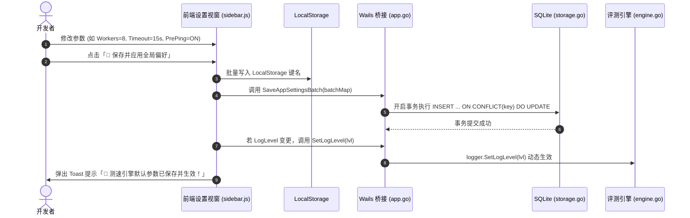
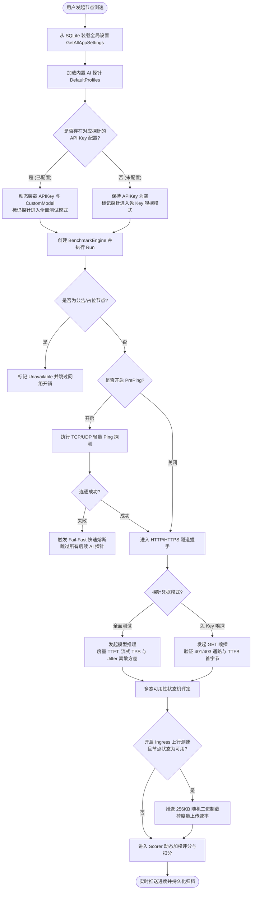

# NodePilot 系统设置、凭据安全管理与运行时治理特性规约 (Settings, Credentials Security & Runtime Governance Specification)

## 一、 功能背景与第一性原理动机 (Overview & Motivation - Why)

### 1.1 业务背景与传统痛点
在传统网络代理测速客户端与节点管理工具中，系统设置与运行时治理通常被视为边缘辅助功能，普遍存在以下四大核心架构痛点：

1. **参数硬编码与黑盒运行，缺乏动态可控性**：
   - 传统工具将并发线程数、TCP 握手超时、HTTP 探测超时等核心引擎参数在代码中硬编码或隐藏在晦涩的配置文件深处；
   - 在高并发压测场景下，面对包含数十个甚至数百个节点的复杂订阅，若网络状况较差或系统资源有限，过激的固定并发会导致宿主本地端口与句柄耗尽、DNS 解析拥塞甚至本机网络假死；而过低的并发则导致全量评测极其缓慢。
2. **AI 服务凭据暴露与安全治理缺失**：
   - 现代 AI IDE（如 Google Antigravity、Cursor、Claude Code、GitHub Copilot 等）需要访问各大模型供应商的专属 API 端点（OpenAI、Anthropic、Google Cloud Code、Gemini 等）；
   - 传统工具要么仅能执行免 Key 的空嗅探，无法评估真实多轮推理与流式吞吐能力；要么要求用户将高权限敏感 API Key 写入不受控的明文脚本或上传至第三方云端服务器，造成严重的凭据泄露风险（API Key 盗刷、账户封禁与工程代码泄露）。
3. **日志观测性与性能开销的剧烈失衡**：
   - 代理协议底层拨号（Shadowsocks, VMess, VLESS, Trojan, Hysteria2, TUIC 等）涉及复杂的 TLS 握手、伪装域名与多层封装。一旦节点探测失败，若缺乏详尽底层日志，排查网络故障如盲人摸象；
   - 但若全量无脑开启 DEBUG 级日志，磁盘 I/O 写放大将极其严重，且日志文件无限膨胀吞噬磁盘空间；此外，更改日志级别往往需要重启应用，破坏了正在进行的评测流程。
4. **桌面生命周期与原生操作系统脱节**：
   - 跨平台 Webview 应用（如 Electron/Wails 框架）在冷启动、窗口重置与深浅色主题切换时，常常出现“白屏闪烁”、“原生标题栏与界面内容撕裂”、“无法快速定位本地存储数据”等粗糙体验，缺乏桌面原生级别的精致工程治理。

### 1.2 NodePilot 第一性原理治理哲学
针对上述痛点，NodePilot 基于 **“本地优先 (Local-First)、零信任无感安全 (Zero-Trust Local Secret Management)、动态可观测性 (Zero-Restart Dynamic Observability) 与优雅生命周期融合”** 四大第一性原理构建了系统设置与运行时治理体系：

- **自适应边界调优 (Elastic Engine Tuning)**：解耦并发工作线程、请求超时、前置预检与 Ingress 载荷规格，提供具备严格边界保护（Guardrails）与出厂自愈（Factory Reset）的动态调优矩阵；
- **非对称多态凭据隔离 (Dual-Track Credential Governance)**：区分“免 Key 基础连通性嗅探”与“真实推理全面压测”，前端提供密码掩码与就绪指示，后端本地 SQLite 强隔离存储，严禁凭据出网离开本机；
- **无感动态热切换日志内核 (Zero-Restart Dynamic Logging)**：支持在 UI 界面实时无缝切换 DEBUG/INFO/WARN/ERROR 日志级别，内置防抖比对与每日自动轮转（Daily Log Rotation），提供原生文件管理器呼出与 760px 应用内实时诊断抽屉双模观测；
- **原生桌面深度契合 (Native Desktop Harmony)**：设计基准分辨率 1200x820，纯深色背景渲染（`#070d18`）根除启动白屏闪烁，macOS `DarkAqua` / Windows `Dark` 原生标题栏深浅联动，单二进制内嵌（Go `embed.FS`）开箱即用。

---

## 二、 核心数据模型与抽象定义 (Data Models - What)

源码定义位置：
- 后端数据持久化模型：[storage.go](../../engine/pkg/storage/storage.go)
- 引擎调度配置：[engine.go](../../engine/pkg/runner/engine.go)
- 探针凭据定义：[types.go](../../engine/pkg/model/types.go)
- 日志级别枚举：[logger.go](../../engine/pkg/logger/logger.go)
- 前端存储与键名规约：[store.js](../../app/frontend/src/js/store.js)、[sidebar.js](../../app/frontend/src/js/sidebar.js)

### 2.1 全局偏好持久化键值表 (`app_settings`)
在 SQLite 中建立单层键值映射表，承载所有系统调优参数、开关与服务凭据：

```sql
CREATE TABLE IF NOT EXISTS app_settings (
    key TEXT PRIMARY KEY,
    value TEXT NOT NULL,
    updated_at TEXT NOT NULL
);
```

### 2.2 核心配置项字典 (Settings Dictionary)

| 配置 Key 名 (`app_settings.key`) | 对应前端 LocalStorage Key | 默认出厂值 | 取值范围 / 枚举 | 作用与治理职责 |
| :--- | :--- | :--- | :--- | :--- |
| `nodepilot_default_workers` | `nodepilot_default_workers` | `"6"` | `1` ~ `20` (整数) | 评测并发工作线程数（Workers 池规模） |
| `nodepilot_default_timeout` | `nodepilot_default_timeout` | `"10"` | `3` ~ `30` (秒) | 单探针 HTTP/HTTPS 探测超时阈值 |
| `nodepilot_tcp_timeout` | `nodepilot_tcp_timeout` | `"3"` | `1` ~ `10` (秒) | TCP 节点连接预检 (Pre-dial) 超时时限 |
| `nodepilot_enable_pre_ping` | `nodepilot_enable_pre_ping` | `"true"` | `"true"` \| `"false"` | 是否开启前置轻量 Ping 探测 (Fail-Fast 快速熔断) |
| `nodepilot_enable_ingress` | `nodepilot_enable_ingress` | `"true"` | `"true"` \| `"false"` | 是否开启代码工程大上下文 Ingress 上行带宽压测 |
| `nodepilot_ingress_payload_size` | `nodepilot_ingress_payload_size`| `"262144"` | `131072` (128KB), `262144` (256KB), `524288` (512KB), `1048576` (1MB) | 上行测试二进制 Payload 规格 (Bytes) |
| `nodepilot_jitter_threshold` | `nodepilot_jitter_threshold` | `"150"` | `80`, `120`, `150`, `200` (ms) | 网络抖动离散方差告警阈值 (超阈值判定代理聚合缓冲) |
| `nodepilot_top_n` | `nodepilot_top_n` | `"5"` | `3`, `5`, `8`, `10` (整数) | Clash / Mihomo 策略组默认注入的优选节点数 |
| `nodepilot_min_score` | `nodepilot_min_score` | `"50"` | `0` ~ `90` (分) | 合格节点入选最低门槛分 (低于此分坚决不注入策略组) |
| `nodepilot_auto_persist` | `nodepilot_auto_persist` | `"true"` | `"true"` \| `"false"` | 测速完成后是否自动持久化到历史档案与节点缓存 |
| `nodepilot_skip_benchmark_confirm`| `nodepilot_skip_benchmark_confirm`| `"false"`| `"true"` \| `"false"` | 是否跳过测速前的链路兼容性说明提示弹窗 |
| `nodepilot_log_level` | `nodepilot_log_level` | `"INFO"` | `"DEBUG"`, `"INFO"`, `"WARN"`, `"ERROR"` | 底层网络探测测试日志的输出过滤级别 |
| `nodepilot_probe_apikey_<id>` | `nodepilot_probe_apikey_<id>` | `""` | 任意字符串 (密码型) | 对应 AI 服务探针的私有 API Key / Token |
| `nodepilot_probe_model_<id>` | `nodepilot_probe_model_<id>` | `""` | 任意模型标识符 | 对应 AI 服务探针指定的自定义模型 (Custom Model) |
| `nodepilot_display_language` | `nodepilot_display_language` | `"auto"` | `"auto"`, `"zh"`, `"en"` | 界面语言：跟随系统或固定中英文 |
| `nodepilot_theme_mode_v1` | `nodepilot_theme_mode_v1` | `"auto"` | `"auto"`, `"dark"`, `"light"` | 界面主题：跟随系统或强制深色/浅色 |
| `nodepilot_sidebar_collapsed` | `nodepilot_sidebar_collapsed` | `"false"` | `"true"` \| `"false"` | 侧边栏折叠/展开持久化记忆 |
| `nodepilot_settings_active_tab`| `nodepilot_settings_active_tab` | `"engine"` | `"engine"`, `"probes"` | 设置页面当前激活的 Tab 选项卡记忆 |

### 2.3 引擎调度配置模型 (`EngineOptions`)
源码位置：`engine/pkg/runner/engine.go`

```go
type EngineOptions struct {
    Concurrency    int           // 并发工作池大小 (对应 workers)
    Timeout        time.Duration // 单次探测最大超时限制 (对应 timeoutSec)
    EnablePrePing  bool          // 是否开启前置 Ping 连通性测试与快速熔断
    PrePingTimeout time.Duration // 前置 Ping 超时时限 (默认 2 秒)
}
```

### 2.4 AI 探针凭据注入扩展模型 (`ProbeProfile`)
源码位置：`engine/pkg/model/types.go`

```go
type ProbeProfile struct {
    ID          string            `json:"id" yaml:"id"`
    Name        string            `json:"name" yaml:"name"`
    Category    string            `json:"category" yaml:"category"`
    Method      string            `json:"method" yaml:"method"`
    Endpoint    string            `json:"endpoint" yaml:"endpoint"`
    Headers     map[string]string `json:"headers,omitempty" yaml:"headers,omitempty"`
    BodyPayload string            `json:"body_payload,omitempty" yaml:"body_payload,omitempty"`

    // 验证规则与多态状态机
    Validation ValidationRule `json:"validation" yaml:"validation"`

    // 性能压测配置
    TestIngress         bool `json:"test_ingress" yaml:"test_ingress"`
    IngressPayloadBytes int  `json:"ingress_payload_bytes" yaml:"ingress_payload_bytes"`
    TestStream          bool `json:"test_stream" yaml:"test_stream"`

    // 凭据与全面测试配置 (运行时动态装载注入)
    APIKey      string `json:"api_key,omitempty" yaml:"api_key,omitempty"`
    CustomModel string `json:"custom_model,omitempty" yaml:"custom_model,omitempty"`
}
```

### 2.5 日志级别与状态机模型 (`logger.Level`)
源码位置：`engine/pkg/logger/logger.go`

```go
type Level int

const (
    LevelDebug Level = iota // 0: 最详尽，包含底层物理拨号、握手、报文
    LevelInfo               // 1: 推荐标准，记录测速流程、核心结果与进度
    LevelWarn               // 2: 仅告警，过滤常规日志，仅记重试降级与异常告警
    LevelError              // 3: 仅错误，仅记录致命错误与测速失败
)
```

---

## 三、 架构设计与核心机制 (Architecture & Mechanics - How)

### 3.1 引擎运行参数调优与治理矩阵 (Engine Tuning & Governance)

```
┌────────────────────────────────────────────────────────────────────────┐
│                        前端设置视窗 (Settings View)                     │
│  [Workers: 6]  [Timeout: 10s]  [Pre-dial: 3s]  [Fail-Fast PrePing: ON] │
│  [Ingress Payload: 256KB]  [Jitter Threshold: 150ms]  [Top-N: 5]       │
└────────────────────────────────────┬───────────────────────────────────┘
                                     │ 保存/自动同步 (SQLite & LocalStorage)
                                     ▼
┌────────────────────────────────────────────────────────────────────────┐
│                      测试发起调度器 (app.go: RunBenchmark)              │
│  - 动态装配 EngineOptions (Concurrency, Timeout, PrePing)              │
│  - 任务通道 buffered chan singleTask (大小: nodes × profiles)          │
└────────────────────────────────────┬───────────────────────────────────┘
                                     │ 分发派发至并发线程池
                                     ▼
┌────────────────────────────────────────────────────────────────────────┐
│                       并发 Worker 执行池 (1 ~ 20 协程)                  │
│                                                                        │
│   Worker 1           Worker 2           Worker 3        ... Worker N   │
│   ┌───────────────┐  ┌───────────────┐  ┌─────────────┐                │
│   │ 节点占位过滤  │  │ 节点占位过滤  │  │ 占位过滤    │                │
│   ├───────────────┤  ├───────────────┤  ├─────────────┤                │
│   │ Fail-Fast 熔断│  │ Fail-Fast 熔断│  │ 熔断检测    │                │
│   ├───────────────┤  ├───────────────┤  ├─────────────┤                │
│   │ 探针上下文测试│  │ 探针上下文测试│  │ 探针测试    │                │
│   └───────┬───────┘  └───────┬───────┘  └──────┬──────┘                │
│           └──────────────────┼─────────────────┘                       │
│                              │ 实时结果推送 (resCh)                     │
│                              ▼                                         │
│                  wailsRuntime.EventsEmit("benchmark_progress")         │
└────────────────────────────────────────────────────────────────────────┘
```

#### 1. 并发线程池调度与限流保护 (Workers Pool)
- **并发度上下限**：硬性限制在 `1` 到 `20` 之间，出厂推荐值为 `6`。
  - 针对低配设备或弱网环境，调低至 `2 ~ 4`，避免本地 CPU 100% 占满或操作系统本地端口（Ephemeral Ports）耗尽；
  - 针对千兆光纤、多核高性能桌面工作站，允许调高至 `10 ~ 16`，显著提升百级节点的大规模评测吞吐。
- **调度缓冲队列**：
  - 后端创建容量等于 `totalTasks = len(nodes) * len(activeProfiles)` 的任务有向缓冲通道 `taskCh`；
  - 启动指定数量（`workers`）的后台独立 Goroutine 抢占消费 `taskCh`；
  - 每个 Worker 内部严格监听 `select { case <-ctx.Done(): return default: ... }`，一旦外部取消评测或上下文超时，所有 Worker 瞬间协同退出，严禁后台 Goroutine 泄漏。

#### 2. 超时梯级分流控制 (Timeout Cascading)
NodePilot 实施严格的两级超时防护：
- **Pre-dial 连接超时 (1 ~ 10 秒，默认 3 秒)**：在物理嗅探节点 Server:Port 可达性时生效，以毫秒级时限快速剔除无响应节点；
- **探针请求全局超时 (3 ~ 30 秒，默认 10 秒)**：涵盖出站隧道握手、TLS 协商、HTTP 请求与首字节接收的全流程。通过 `context.WithTimeout(parentCtx, timeout)` 实行单节点单探针严格隔离，防止极个别卡顿的慢节点挂死全局队列。

#### 3. 前置轻量 Ping 探测与短路熔断 (Fail-Fast Short-Circuit)
在正式拉起高开销的 HTTP 探针与 TLS 握手前，前置探测引擎先行接入：
1. **占位与公告节点智能过滤**：
   - 自动匹配包含“到期、剩余流量、官网、通知、notice、expire”等非代理节点，或 `Server` 为 `127.0.0.1` / `localhost` 等非法地址，直接标记为 `Unavailable` 并跳过网络开销；
2. **协议感知物理嗅探 (`PingNode`)**：
   - **直连节点 (`direct`)**：直接返回 `1ms`，连通状态为 `ok`；
   - **TCP 代理协议（Trojan, Shadowsocks, VMess, VLESS 等）**：使用原生 `net.Dialer` 对 `node.Server:node.Port` 发起轻量 TCP 握手 RTT 测试；
   - **UDP/QUIC 协议（Hysteria2, TUIC 等）**：通过 Mihomo 内核出站隧道发起至公共可靠端点（如 `cp.cloudflare.com:80`）的轻量拨号握手；
3. **快速短路熔断**：
   - 一旦前置 Ping 失败（超时或连接重置），该节点被直接判定为 `Unavailable`，设置 `PingStatus = "unreachable"`，**直接短路跳过后续所有 5 大 AI 探针的 HTTP 探测与 Ingress 测速**，为整组评测节省数分钟的无效等待。

#### 4. 大上下文 Ingress 上行载荷规格调优
现代 AI 辅助编程单次 Prompt 携带大量代码 AST 与工程依赖，NodePilot 允许用户按需配置模拟上传规格：
- `128 KB`：轻量极速，适合低流量配额机场快速测试；
- `262144 Bytes (256 KB)`：官方推荐标准，精确评估复杂上下文推送能力；
- `524288 Bytes (512 KB)`：中长上下文，适合多文件重构场景压力测试；
- `1048576 Bytes (1024 KB)`：极限大工程压测，真实识别运营商上行 QoS 限速与严重丢包。
- **测速机制**：通过 `crypto/rand` 实时生成高熵二进制随机流向端点推送，利用 HTTP 连接实时计算纳秒级字节传输速率并转换为 `Bytes/s` 与 `Mbps`。

#### 5. 抗抖动告警与缓冲劫持扣分策略
- 阈值选项：`80 ms` (极度严苛)、`120 ms` (敏捷编码)、`150 ms` (官方推荐)、`200 ms` (宽松宽容)；
- 当探针捕获到的流式 Chunk 到达时间方差超过该阈值时，触发 `ProxyBufferDetected = true`；
- 评分引擎在计算综合得分时，强制施加 **30% 降权扣分惩罚**，并将该节点在界面中打上 `⚠️ 缓冲劫持` 警告徽标，引导用户避开攒包暴吐的劣质线路。

---

### 3.2 AI 专属服务探针凭据安全管理 (Credentials Security Management)

#### 1. 服务维度独立凭据配置
NodePilot 针对当前主流 AI 辅助编程与核心推理模型，提供五大内置探针的独立凭据与模型注入：

| 探针 ID (`probeId`) | 目标平台 | 端点地址 (`Endpoint`) | 关键鉴权 Header / 机制 | 默认推荐模型 (`CustomModel`) |
| :--- | :--- | :--- | :--- | :--- |
| `google-antigravity` | Google Antigravity | `cloudcode-pa.googleapis.com` | `Authorization: Bearer <token>` | `gemini-1.5-flash` |
| `openai` | OpenAI / ChatGPT | `api.openai.com/v1/models` | `Authorization: Bearer <sk-...>` | `gpt-4o-mini` |
| `anthropic-claude` | Anthropic Claude | `api.anthropic.com/v1/messages` | `x-api-key: <sk-ant-...>` | `claude-3-5-sonnet-20241022` |
| `google-gemini` | Google Gemini | `generativelanguage.googleapis.com` | `x-goog-api-key: <AIza...>` | `gemini-1.5-flash` |
| `cursor` | Cursor IDE Gateway | `api2.cursor.sh` | `Authorization: Bearer <token>` | `cursor-fast` |

#### 2. 凭据全链路流转与安全注入架构

```
┌────────────────────────────────────────────────────────────────────────┐
│                        前端安全呈现层 (UI Layer)                        │
│   [密码输入框 type="password"] ◄──► [眼睛图标切换明文/密文]             │
│   [状态指示徽标]: ✅ 已配置 (ready)  /  ⚠️ 缺少配置 (missing)            │
└────────────────────────────────────┬───────────────────────────────────┘
                                     │ input/change 事件防抖落盘
                                     ▼
┌────────────────────────────────────────────────────────────────────────┐
│                        本地持久化层 (Storage Layer)                     │
│   - LocalStorage: nodepilot_probe_apikey_<id>, nodepilot_probe_model   │
│   - SQLite: app_settings (完全位于用户本机 ~/.nodepilot/nodepilot.db)   │
│   ★ 绝对绝缘：严禁向任何云端、遥测服务或第三方中继同步密钥 ★             │
└────────────────────────────────────┬───────────────────────────────────┘
                                     │ a.RunBenchmark() 调用 GetAllAppSettings()
                                     ▼
┌────────────────────────────────────────────────────────────────────────┐
│                       后端运行时装配 (app.go)                           │
│   for i := range activeProfiles {                                      │
│       activeProfiles[i].APIKey = settings["nodepilot_probe_apikey_" + id]│
│       activeProfiles[i].CustomModel = settings["nodepilot_probe_model_"]│
│   }                                                                    │
└────────────────────────────────────┬───────────────────────────────────┘
                                     │ 注入运行期探针上下文
                                     ▼
┌────────────────────────────────────────────────────────────────────────┐
│                       探针执行决策分流 (Dual-Mode Execution)            │
│   if profile.APIKey == "" {                                            │
│       // 模式 A: 免 Key 嗅探模式 (Connectivity Sniffing)               │
│       // 执行 GET 握手、HTTP 401/403 通路验证、TTFB 测量、256K Ingress  │
│   } else {                                                             │
│       // 模式 B: 真实推理全面测试模式 (Full Inference & Stream TPS)     │
│       // 注入鉴权 Header，发起流式补全，度量精确 TTFT、TPS 与 Jitter     │
│   }                                                                    │
└────────────────────────────────────────────────────────────────────────┘
```

#### 3. 凭据安全防护规范 (Security Guardrails)
- **前端掩码保护**：API Key 输入框默认采用 `type="password"`，禁止浏览器自动填充（`autocomplete="off"`）与拼写检查（`spellcheck="false"`），仅允许用户通过显式点击 👁️ 图标临时查看明文；
- **状态感知指示器**：动态监听 Key 输入长度，实时切换徽标：
  - `✅ 已配置`（绿色徽标，提示全面测试已就绪）；
  - `⚠️ 缺少配置`（黄色徽标，明确提示全面测试不可用，回退至免 Key 嗅探）；
- **日志敏感信息过滤**：底层网络日志（Logger）在记录请求头与报文时，一律阻断输出含有 `Authorization`、`x-api-key`、`x-goog-api-key`、`sk-` 关键字的敏感参数，杜绝日志落盘泄密。

---

### 3.3 运行时日志热治理与双模观测台 (Logging & Diagnostics)

#### 1. 日志级别运行时无缝切换 (Zero-Restart Log Level Switch)
- 支持 `DEBUG`、`INFO`、`WARN`、`ERROR` 四级平滑切换；
- **防抖比对机制**：
  ```go
  func SetLogLevel(levelStr string) bool {
      mu.Lock()
      defer mu.Unlock()
      newLevel := parseLevel(levelStr)
      if newLevel == currentLevel {
          return false // 级别未改变，不产生多余锁操作与 I/O 开销
      }
      currentLevel = newLevel
      return true
  }
  ```
  前端通过下拉框切换日志级别时，立即调用 `window.go.main.App.SetLogLevel(lvl)`，控制台实时生效，无需重启桌面进程。

#### 2. 日志物理落盘与日轮转 (Daily Log Rotation)
- **存储路径定位**：
  - 自动向上递归探测项目根目录 `logs/`，若不可写则回退至用户临时目录 `nodepilot-logs/`；
  - 命名格式强制规范：`nodepilot-test-yyyy-MM-dd.log`（例如 `nodepilot-test-2026-11-18.log`）；
- **无锁/双重缓冲写入**：
  - 在 `logMessage` 写入时检测当前日期，跨天自动创建新日志文件并关闭旧文件句柄；
  - 写入通道同时输出到 `os.Stdout` 与物理磁盘文件。

#### 3. 双模观测交互 (Dual-Mode Observation Interface)
- **原生文件管理器直达 (`OpenLogDir`)**：
  - 调用操作系统底层 API（macOS 执行 `open <dir>`，Windows 执行 `explorer <dir>`，Linux 执行 `xdg-open <dir>`），一键呼出原生文件夹，方便工程师拷取日志；
- **760px 应用内实时诊断抽屉 (`runtime_log.js`)**：
  - 界面提供快速呼出按钮（顶部工具栏 📋 与设置页「查看测试日志」）；
  - 支持最近 300 行日志反向读取、语法色彩高亮（`[ERROR]` 鲜红、`[WARN]` 金黄、`[INFO]` 浅灰/鲜绿、`[DEBUG]` 紫色）；
  - 内置自动滚动尾随（Auto-Scroll）、一键刷新与一键复制全部日志至剪贴板功能。

---

### 3.4 桌面应用生命周期与原生桌面融合 (Desktop Lifecycle & Governance)

#### 1. 窗口规格与渲染参数
源码位置：`app/main.go`、`app/wails.json`

```go
wails.Run(&options.App{
    Title:  "NodePilot · AI IDE 代理节点全维度测速与智能优选",
    Width:  1200, // 黄金桌面宽度，完美承载 9 大指标列与侧边栏
    Height: 820,  // 适配 13~16 英寸主流笔记本屏幕纵向高度
    AssetServer: &assetserver.Options{
        Assets: assets, // Go 1.16+ embed.FS 单二进制内嵌
    },
    BackgroundColour: &options.RGBA{R: 7, G: 13, B: 24, A: 1}, // 与主题 --bg-dark (#070d18) 严格一致，根除白屏闪烁
    OnStartup:        app.startup,
    Bind: []interface{}{
        app,
    },
    Mac: &mac.Options{
        TitleBar:             mac.TitleBarDefault(),
        Appearance:           mac.NSAppearanceNameDarkAqua, // 原生深色系统标题栏
        WebviewIsTransparent: false,
        WindowIsTranslucent:  false,
    },
    Windows: &windows.Options{
        WebviewIsTransparent: false,
        WindowIsTranslucent:  false,
        Theme:                windows.Dark, // Windows 原生深色外框
    },
})
```

#### 2. 运行时原生深浅主题联动 (`SetNativeTheme`)
- 前端通过三段式切换器 (`auto` / `dark` / `light`) 切换主题时，不仅改变 HTML DOM 根结点的 `data-theme` 属性，而且通过 IPC 动态调用：
  ```go
  func (a *App) SetNativeTheme(theme string) {
      if strings.ToLower(theme) == "light" {
          wailsRuntime.WindowSetBackgroundColour(a.ctx, 255, 255, 255, 255)
      } else {
          wailsRuntime.WindowSetBackgroundColour(a.ctx, 7, 13, 24, 255)
      }
  }
  ```
  在操作系统窗口层面实现无缝同步变色，消除窗口边界视觉割裂感。

#### 3. 进程单实例与生命周期协同
- **Wails Context 托管**：`app.startup(ctx)` 捕获运行期主上下文，作为全生命周期内后台任务取消与 Wails 事件推送的唯一起点；
- **全流程进度广播**：测速期间通过 `wailsRuntime.EventsEmit(a.ctx, "benchmark_progress", payload)` 将当前完成任务数、总任务数、百分比及最新节点评测结果实时广播至前端，保持毫秒级界面响应。

---

## 四、 关键业务场景与流转时序 (Key Workflows & Sequence)

### 4.1 全局偏好与引擎参数保存生效时序



### 4.2 探针凭据装配与全面测速决策流程



---

## 五、 边界防御、容错降级与性能治理 (Edge Cases, Fault Tolerance & Performance)

### 5.1 SQLite 并发写入冲突与防锁死机制
- **WAL 模式与 Busy 容忍**：连接字符串强制开启 `_pragma=busy_timeout(5000)&_pragma=journal_mode(WAL)&_pragma=synchronous(NORMAL)`，即便多线程并发读取历史图表与日志，设置写入事务最长可等待 5 秒，彻底解决 SQLite `database is locked` 异常；
- **单写入句柄保护**：`db.SetMaxOpenConns(1)` 确保所有偏好设置与评测快照写入严格串行化，杜绝多句柄锁竞争；
- **冷启动平滑双轨迁移**：首次运行或旧版本升级时，若 SQLite 为空，前端自动扫描 LocalStorage 历史偏好并无损迁移注入 SQLite `app_settings`，保障用户无需重新输入 API Key。

### 5.2 边界校验与出厂重置自愈 (Guardrails & Factory Reset)
- **边界防御**：
  - 若用户在输入框中填入非法字符或负数，输入框设置 `min` 与 `max` 约束；后端在 `RunBenchmark` 阶段强制实施下限防线：
    ```go
    if workers <= 0 { workers = 5 }
    if timeoutSec <= 0 { timeoutSec = 10 }
    ```
- **出厂一键自愈 (`btn-reset-settings`)**：
  - 点击「🔄 恢复默认」，系统弹窗确认后，强制将所有参数覆写回官方出厂基线：
    `workers=6`, `timeout=10s`, `tcpTimeout=3s`, `prePing=true`, `ingress=true`, `payload=256KB`, `jitter=150ms`, `topN=5`, `minScore=50`, `logLevel=INFO`；
  - 自动触发保存并向用户弹出自愈成功提示。

### 5.3 慢节点、假死与幽灵 Goroutine 阻断
- 当用户测试包含 100+ 节点的庞大订阅时，可能遭遇恶意断流或无限挂起的慢节点；
- 引擎对单次探测使用 `context.WithTimeout(parentCtx, timeout)` 实行严格倒计时包围；
- 在建立出站连接时使用自定义 Transport，强制设置 `DisableKeepAlives: true` 与 `MaxIdleConnsPerHost: -1`，确保每次探测结束后底层 Socket 立即回收，防止操作系统句柄泄漏。

---

## 六、 固化验收标准与测试断言 (Verification & Assertions)

为防止后续代码重构、跨端移植或功能演化过程中出现设置与运行时治理特性的悄然漂移（Feature Drift），必须严格满足以下测试断言：

### 6.1 设置持久化读写断言 (`TestStorage_SettingsCRUD`)
```go
// 1. 单项设置幂等写入与读取
err := store.SetSetting("nodepilot_default_workers", "8")
assert.NoError(t, err)
val, err := store.GetSetting("nodepilot_default_workers")
assert.NoError(t, err)
assert.Equal(t, "8", val)

// 2. 批量设置事务原子性
batch := map[string]string{
    "nodepilot_default_workers": "10",
    "nodepilot_default_timeout": "15",
    "nodepilot_log_level":       "DEBUG",
}
err = store.SetSettingsBatch(batch)
assert.NoError(t, err)
all, err := store.GetAllSettings()
assert.NoError(t, err)
assert.Equal(t, "10", all["nodepilot_default_workers"])
assert.Equal(t, "15", all["nodepilot_default_timeout"])
assert.Equal(t, "DEBUG", all["nodepilot_log_level"])
```

### 6.2 探针凭据掩码与流转断言 (`AssertProbeCredentials`)
- **断言 1 (前端输入掩码)**：探针凭据输入框初始 `type` 属性必须为 `password`，点击眼睛按钮切换为 `text`，再次点击必须恢复为 `password`；
- **断言 2 (状态指示一致性)**：当 `keyInput.value.trim().length > 0` 时，徽标 `dataset.status` 必须为 `ready` 并呈现绿色；当值为空时，徽标 `dataset.status` 必须为 `missing` 并呈现黄色警告；
- **断言 3 (后端装载注入)**：在 `app.go` 调用 `RunBenchmark` 时，装配的 `activeProfiles` 必须能够正确读取并注入配置的 `APIKey` 与 `CustomModel`，当且仅当数据库中存在对应键时生效。

### 6.3 引擎调度参数边界断言 (`AssertEngineOptions`)
- **断言 1 (Workers 兜底)**：当传入 `workers <= 0` 时，引擎必须强制纠正为 `5`，杜绝 `0` 并发导致的任务锁死；
- **断言 2 (Timeout 兜底)**：当传入 `timeoutSec <= 0` 时，必须纠正为 `10s`；
- **断言 3 (Fail-Fast 熔断时延)**：开启 `EnablePrePing` 时，若节点物理离线，必须在 `PrePingTimeout`（<= 2s）内立即返回 `StatusUnavailable`，严禁触发耗时 10s 以上的后续 HTTP 探测。

### 6.4 日志级别去重防抖断言 (`TestSetLogLevelChangeDetection`)
源码位置：`engine/pkg/logger/logger_test.go`

```go
// 1. 设置当前相同的级别必须返回 false，杜绝无意义磁盘写锁
SetLogLevel("INFO")
assert.False(t, SetLogLevel("INFO"))
assert.False(t, SetLogLevel("info "))

// 2. 切换至新级别必须返回 true，且全局级别即时刷新
assert.True(t, SetLogLevel("DEBUG"))
assert.Equal(t, "DEBUG", GetLogLevel())
assert.False(t, SetLogLevel("DEBUG"))

// 3. 复原出厂值
SetLogLevel("INFO")
assert.Equal(t, "INFO", GetLogLevel())
```

### 6.5 桌面生命周期与原生适配断言 (`AssertDesktopLifecycle`)
- **断言 1 (设计分辨率)**：桌面启动默认 `Width = 1200`，`Height = 820`；
- **断言 2 (启动底色防闪)**：`BackgroundColour` 必须严格设定为 `RGBA{7, 13, 24, 1}`（对应 `#070d18`），杜绝启动白屏闪烁；
- **断言 3 (单二进制内嵌)**：前端构建产物必须通过 Go 原生 `//go:embed all:frontend/src` 内嵌至二进制文件中，宿主机无需安装任何额外的前端运行环境即可独立运行。
